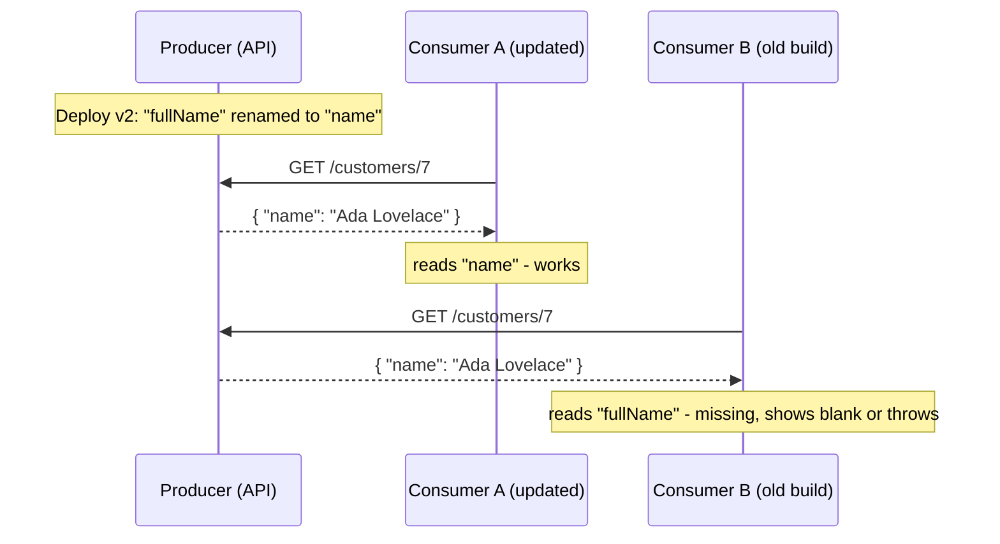

# Changing a contract in an established project without breaking consumers

## TL;DR

A **contract** is whatever a producer and its consumers agree on: an HTTP API shape, a DTO, a message or event schema, a shared database table, a shared library's public types. In an established project you can't change both sides at the same instant, so a change that is fine in a single codebase becomes a **breaking change** the moment someone else's deployed code depends on the old shape. The usual answer is to make the old and the new shape **coexist for a while**: prefer additive changes, use **expand → migrate → contract** (parallel change) for real changes, and reach for explicit **versioning** only when you can't express the change additively or can't control the consumers.

## The problem

A team owns an ASP.NET Core API. It has several consumers: a web frontend, a mobile app, two other internal services, and a nightly job that reads the same database. The API has been in production for years. Now a contract has to change. Typical triggers:

- A field is renamed or split (`FullName` becomes `FirstName` and `LastName`).
- A field's type or meaning changes (`Price` was an `int` in cents, now a `decimal` in currency units).
- An optional field becomes required.
- An endpoint's response shape is reorganized, or paging is added to a list that used to return everything.
- An event on a message bus gets a new structure.

The developer's instinct is to edit the DTO, fix the compiler errors in the repo, and deploy. The tests pass. Then the mobile app, which users update slowly, starts failing, or a different team's service starts throwing deserialization errors after the next deploy.

**Root cause:** the compiler only checks the code in your repository. The contract's real users are deployed binaries you can't see, can't recompile, and can't update on your schedule.

## Why it happens

### 1. Producer and consumers deploy independently

Follow one rename through a normal rolling deployment:



Even if you own every consumer, they don't all deploy at the same moment, so there is always a window where old and new code run side by side. Fowler's description of parallel change makes the same point: it exists so changes can be released safely in any phase, including with canary and blue-green releases, where two versions run at once [1].

### 2. A contract has two directions

A contract is not one thing but two:

- **Responses** (producer → consumer): the consumer *reads* data in the producer's shape.
- **Requests and published events** (consumer → producer, or producer → many subscribers): the producer or the subscriber *reads* data in someone else's shape.

Schema-evolution vocabulary names the two directions. **Backward compatible** means a reader on the *new* schema can read data written with the *old* one. **Forward compatible** means a reader on the *old* schema can read data written with the *new* one [10]. For an HTTP response you need *forward* compatibility (old clients reading new responses). For a request you need *backward* compatibility (new server reading old clients' requests). Most breakage comes from checking only one direction.

### 3. "Additive" is not automatically safe

A rough rule of thumb (my summary, not a formal standard):

| Change | Response (old clients read it) | Request (new server reads it) |
| --- | --- | --- |
| Add an optional field | Safe for tolerant readers | Safe |
| Add a **required** field | Safe for tolerant readers | **Breaking**: old clients don't send it [5] |
| Remove a field | **Breaking** | Safe unless the server rejects unknown members [4] |
| Rename a field | **Breaking** | **Breaking** |
| Change a field's type or meaning | **Breaking** | **Breaking** |
| Add an enum value | Can break exhaustive `switch` code [8] | Safe |
| Remove an enum value | **Breaking** [5] | **Breaking** |

Microsoft's Azure API guidelines list the breaking cases explicitly: introducing a required field after v1, removing a required field, switching a field between required and optional in either direction, removing an enum value, adding paging to an existing collection, and returning a different top-level error code for the same condition [5].

Two caveats:

- **Additions can still break strict consumers.** By default, `System.Text.Json` ignores JSON properties that don't exist on the target type, but since .NET 8 you can configure it to throw instead, with `JsonUnmappedMemberHandling.Disallow` [4]. A consumer that opted into that, or a client generated from a strict schema, breaks on a new field.
- **Adding an enum value is "wire-safe" but not code-safe.** Protobuf's guide says it can still break application code such as exhaustive `switch` statements [8].

### 4. Hyrum's Law: the contract is bigger than what you wrote down

Hyrum Wright's observation, named and popularized by Titus Winters: with enough users of an API, "all observable behaviors of your system will be depended on by somebody" [2]. That includes field order, undocumented fields, error message text, timing, and bugs. So "nobody should be using that" is not evidence that nobody does. This is why every option below includes some way to *measure* who uses what.

### 5. The consumer's side matters too

Fowler's **Tolerant Reader** says a consumer should take only the fields it needs, ignore the rest, and make minimal assumptions about structure. He warns that generated bindings (for example classes generated from an XSD) often tie the consumer to the exact shape of the contract and break this principle [3]. A producer can only evolve freely if consumers read tolerantly, and you usually control that on only some of them.

## Options and solutions

All options assume a typical ASP.NET Core (.NET 10) API with several consumers that you don't deploy in lockstep.

### Option 1: Additive-only evolution (tolerant reader)

Only ever add: optional fields, new endpoints, new event types. Never remove, rename, or repurpose. Consumers are written (and, where you can, configured) to ignore what they don't recognize [3][4].

- **Grade:** 8/10. The cheapest option and the right default, but it can't express a real breaking change.
- **Pros:**
  - No coordination and no migration phase.
  - Nothing to clean up.
  - Works the same for HTTP, events and shared libraries.
- **Cons:**
  - Cruft accumulates: old fields stay forever.
  - Additions can still break strict consumers and exhaustive `switch` code (see *Why it happens*, section 3).
  - It does nothing when the *meaning* of a field has to change.
- **Use when:** The change is genuinely an addition, or you are designing a new contract and want to leave room to grow.

### Option 2: Expand → migrate → contract (parallel change)

Also called *expand and contract*. Fowler describes three phases [1]:

| Phase | What you do | Example: split `FullName` |
| --- | --- | --- |
| **Expand** | Add the new shape *next to* the old one. Everything old keeps working. | Responses return `FullName` **and** `FirstName`/`LastName`. Requests accept either. |
| **Migrate** | Move consumers to the new shape one by one. For external consumers this is usually the longest phase [1]. | Update the web app, then mobile, then the other services. |
| **Contract** | When nothing uses the old shape, remove it. | Delete `FullName`. |

Support it with **measurement and signals**: count requests that still use the old shape (so "safe to delete" is data, not a guess, see Hyrum's Law [2]), and tell consumers with the `Deprecation` and `Sunset` HTTP headers [14][15].

The same pattern applies to database changes and to evolving remote APIs, and a feature flag can control which shape a consumer gets during the migration [1].

- **Grade:** 9/10. The default for any change that isn't purely additive.
- **Pros:**
  - No downtime and no coordinated deployment.
  - Every phase is a safe stopping point and can be rolled back.
  - Works for API fields, DB columns, events and library methods.
- **Cons:**
  - You support two versions during the migration, and people can get confused about which is new and which is old [1].
  - Takes weeks or months with external consumers.
  - **If the contract phase is skipped you can end up worse off than before** [1]. It needs an owner and a date.
- **Use when:** A real change to an established contract with consumers you can identify or measure.

### Option 3: Explicit versioning

Publish the new contract as a new version and run both: `/v2/...`, `?api-version=2.0`, a header, or a media type. In ASP.NET Core, the `Asp.Versioning.Http` (minimal APIs) and `Asp.Versioning.Mvc` (controllers) packages provide this [6], and the project's archived wiki lists query string, header, media type and URL path as supported ways to carry the version [7].

Rather than major versions, Stripe uses **date-based versions** (for example `2017-05-24`), each bundling a small set of breaking changes. A new account is pinned to the newest version on its first request, can override it per request with a `Stripe-Version` header, and upgrades when ready [9]. Stripe's stated motivation is avoiding "stranded" users who never migrate a painful major version, forcing the provider to either cut them off or maintain old code forever [9].

For **libraries** (a shared NuGet package), the equivalent is Semantic Versioning: a breaking change bumps MAJOR, an addition bumps MINOR, and deprecated functionality should ship in at least one minor release before a major release removes it [11].

- **Grade:** 7/10. Clean and explicit, but it multiplies what you maintain.
- **Pros:**
  - Consumers opt in to the break on their own schedule.
  - A clear place to put big redesigns.
  - Good for external consumers you can't track.
- **Cons:**
  - Every version in production is code you test, secure and fix bugs in.
  - Versioning too eagerly (a new version for every small change) is an anti-pattern: it turns each fix into a fork.
  - You still need a deprecation and removal policy, or old versions live forever.
- **Use when:** The change is semantic (same field, new meaning), the redesign is large, or consumers are external and uncountable.

### Option 4: Keep the old contract as an adapter over the new model

Change your internal model freely, and keep the old contract alive as a thin **adapter** (facade) layer that translates old requests into the new model and new results back into the old shape. Stripe's design is a sophisticated form of this: each breaking change lives in a "version change module" with a transformation, and a response is built in the newest shape and then walked backward through the modules until it reaches the version the consumer is pinned to [9].

- **Grade:** 7/10. It frees your internals, at the price of mapping code to maintain.
- **Pros:**
  - Internals can change without waiting for consumers.
  - Legacy behavior is isolated in one place instead of spread through the core.
  - Pairs naturally with Options 2 and 3: the adapter *is* the "old" side during migration.
- **Cons:**
  - Mapping code must be tested, and it can quietly become permanent.
  - Some old behaviors can't be expressed on top of the new model.
  - It hides the question "who still uses the old contract?" unless you add telemetry.
- **Use when:** The *internal* redesign is the goal, and consumers will migrate slowly (or never).

### Option 5: Big-bang lockstep release

Change the producer and every consumer in one coordinated deployment.

- **Grade:** 3/10. Simple on paper, fragile in practice.
- **Pros:**
  - No compatibility code and no cleanup phase.
  - Fine when producer and consumer are one deployable unit.
- **Cons:**
  - Rollback means rolling back everything at once.
  - One team that can't deploy that day blocks all the others.
  - Across independently deployed services it's the *distributed monolith* smell **[unverified]** (a community term).
  - It cannot work for consumers you don't control, such as mobile apps or external clients.
- **Use when:** Producer and consumer live in one repository and ship together as a single unit, such as a monolith's own controller and view model.

### Recommendation

| Option | Grade | Best for |
| --- | --- | --- |
| 2. Expand → migrate → contract | 9/10 | Any real change to an established contract |
| 1. Additive-only | 8/10 | New fields and endpoints; the default for design |
| 3. Explicit versioning | 7/10 | Semantic changes, big redesigns, external consumers |
| 4. Adapter over the new model | 7/10 | Internal redesign with slow-migrating consumers |
| 5. Lockstep release | 3/10 | One repo, one deployable |

Start by classifying the change using the table in *Why it happens*, section 3.

1. **It's an addition?** Use Option 1.
2. **It's a change to something existing?** Use Option 2, and add Option 4's adapter if the old shape is awkward to keep alive.
3. **It's a change of meaning, or the consumers are external?** Add a new version (Option 3), and still run it through a deprecation policy.

Whatever you pick, add two guardrails: a way to **detect** breaking changes before deploy (contract tests, see below) and a way to **measure** use of the old shape.

What you give up: speed and tidiness. You carry two shapes for a while, someone has to own the removal date, and the code gets temporarily uglier. The alternative (a surprise outage in a consumer you didn't know existed) is worse.

## What the industry does

- **Parallel change / expand and contract** is the standard technique for incompatible changes to interfaces with external or many consumers, for databases and for remote APIs [1].
- **Strict compatibility rules for schemas.** Message-bus schema registries enforce modes such as BACKWARD, FORWARD and FULL (and "transitive" variants that check against all earlier versions), and the order you upgrade producers and consumers depends on the mode. For example, BACKWARD means upgrade consumers first, and FULL lets producers and consumers upgrade independently [10]. Protobuf's guide says never reuse a field number, and to reserve the numbers and names of removed fields [8].
- **Date-based or rolling versions** (Stripe) instead of big "v2" rewrites, with each breaking change isolated in a module [9].
- **Published breaking-change rules.** Azure's guidelines say what counts as breaking, and that breaking changes need approval, advance customer communication and a long deprecation period [5].
- **Machine-readable deprecation.** `Deprecation` (RFC 9745, March 2025) tells a client that a resource is, or will be, deprecated, and `Sunset` (RFC 8594) says when it is expected to stop responding. The `Sunset` date must not be earlier than the `Deprecation` date. Both are hints and don't change the resource's behavior [14][15].
- **Consumer-driven contract testing.** With Pact, each consumer's tests generate a contract of the requests and responses it actually relies on, and the provider verifies against it. Because only what consumers use is tested, the provider can change unused behavior freely [12]. A tool called `can-i-deploy` asks the Pact Broker whether the version you're about to deploy has a successful verification against every integrated application version already in the target environment [13].
- **Tooling that diffs two OpenAPI documents** to flag breaking changes in CI also exists **[unverified]** (I did not check a specific tool).

**Anti-patterns:**
- **Editing the contract in place** because "it compiles".
- **Never finishing the contract phase**, leaving permanent dual shapes [1].
- **Removing something because "nobody uses it"** with no usage data (Hyrum's Law [2]).
- **Silent semantic changes**: keeping the field name but changing what it means. No schema diff catches it.
- **Reusing a removed identifier** (a Protobuf field number, an error code, an enum value) for something new [8].
- **A new version for every small change.**
- **Strict consumers by default**, such as rejecting unknown JSON members or generating tightly bound clients [3][4].

## Concepts to look up

- **API contract / breaking change:** what consumers may rely on, and a change that invalidates that reliance.
- **Backward and forward compatibility:** new readers reading old data, and old readers reading new data [10].
- **Parallel change (expand and contract):** the three-phase technique for making an incompatible change safely [1].
- **Tolerant Reader:** a consumer that ignores what it doesn't understand and depends on as little structure as possible [3].
- **Hyrum's Law:** every observable behavior eventually gets depended on [2].
- **Consumer-driven contracts (Pact):** contracts generated from what consumers actually use [12].
- **API versioning:** URL, query string, header, media type, or date-based schemes [6][7][9].
- **Semantic Versioning:** MAJOR.MINOR.PATCH and what each bump promises [11].
- **Deprecation and sunset:** announcing, then removing, old functionality [14][15].
- **Schema evolution / schema registry:** compatibility rules for serialized data and events [8][10].
- **Anti-corruption layer / adapter:** a translation layer between an old model and a new one. The term comes from Domain-Driven Design (Eric Evans) **[unverified]**.
- **Branch by abstraction:** an alternative way to swap an implementation behind an abstraction; Fowler suggests considering it when there are many clients [1].

## Example

The code targets .NET 10 (LTS) with ASP.NET Core minimal APIs. The scenario is splitting `FullName` into `FirstName` and `LastName`.

**Before:**

```csharp
public sealed record CustomerDto(int Id, string FullName);
```

**Phase 1, expand.** The response carries both shapes, and the request accepts either. `[Obsolete]` is a *compile-time* signal for C# callers (for example a shared DTO library). It produces a warning, or an error if you pass `true` [16], and it tells JSON consumers nothing.

```csharp
public sealed record CustomerDto
{
    public required int Id { get; init; }

    // New shape.
    public required string FirstName { get; init; }
    public required string LastName { get; init; }

    // Old shape: still served until every consumer has migrated.
    [Obsolete("Use FirstName and LastName. Planned removal after consumers migrate.")]
    public string FullName => $"{FirstName} {LastName}";
}

// Request: old clients send FullName, new clients send the two parts.
public sealed record CreateCustomerRequest(string? FirstName, string? LastName, string? FullName);
```

**Normalize at the edge and measure the old shape.** One place converts old input to the new model, and a counter shows when the old shape is no longer used (so the contract phase is a decision backed by data).

```csharp
using System.Diagnostics.Metrics;

public sealed class ContractUsage
{
    private readonly Counter<long> _legacyFullName;
    public ContractUsage(IMeterFactory meters) =>
        _legacyFullName = meters.Create("MyApp.Contracts")
            .CreateCounter<long>("customers.create.legacy_full_name");

    public void LegacyFullNameUsed() => _legacyFullName.Add(1);
}

app.MapPost("/customers", (CreateCustomerRequest req, ContractUsage usage) =>
{
    string first, last;
    if (req.FirstName is not null && req.LastName is not null)
    {
        (first, last) = (req.FirstName, req.LastName);              // new shape
    }
    else if (req.FullName is { Length: > 0 })
    {
        usage.LegacyFullNameUsed();                                  // count old-shape callers
        var parts = req.FullName.Split(' ', 2, StringSplitOptions.TrimEntries);
        (first, last) = (parts[0], parts.Length > 1 ? parts[1] : "");
    }
    else return Results.BadRequest("Provide FirstName and LastName.");

    // ... create the customer from first/last ...
    return Results.Created($"/customers/1", new { FirstName = first, LastName = last });
});
```

**Signal deprecation to consumers.** `Deprecation` is a structured-header date written as `@<unix seconds>` [14], and `Sunset` is a normal HTTP date [15]. The date arithmetic is done by the framework so the weekday and timestamp can't be mistyped.

```csharp
var deprecatedOn = new DateTimeOffset(2026, 12, 1, 0, 0, 0, TimeSpan.Zero);
var sunsetOn     = new DateTimeOffset(2027, 6, 1, 0, 0, 0, TimeSpan.Zero);

app.MapGet("/v1/customers/{id:int}", (int id, HttpResponse res) =>
{
    res.Headers["Deprecation"] = $"@{deprecatedOn.ToUnixTimeSeconds()}";
    res.Headers["Sunset"]      = sunsetOn.ToString("R");   // RFC 1123 date, e.g. "Tue, 01 Jun 2027 00:00:00 GMT"
    // ... return the old shape ...
    return Results.Ok();
});
```

**Phase 3, contract.** When the counter has been zero for long enough and the `Sunset` date has passed, delete `FullName` from the DTO, delete the fallback branch, and delete the counter. Write the removal date down when you start (an issue, or an ADR), or the cleanup never happens.

**If you do need a new version** (Option 3), `Asp.Versioning` lets one route serve two versions [6]. This is adapted from the library's own minimal API sample:

```csharp
builder.Services.AddApiVersioning();

var app = builder.Build();
var customers = app.NewVersionedApi().MapGroup("/customers");

var v1 = customers.MapGroup("/").HasApiVersion(1.0);
var v2 = customers.MapGroup("/").HasApiVersion(2.0);

// GET /customers?api-version=1.0  -> old shape (adapter over the new model, Option 4)
v1.MapGet("/", () => /* old shape */ Results.Ok());
// GET /customers?api-version=2.0  -> new shape
v2.MapGet("/", () => /* new shape */ Results.Ok());
```

## Check your understanding

1. You rename a response field and every test in your repo still passes. Why can the rename still break production?

   <details><summary>Answer</summary>

   The tests only exercise code in your repository. Deployed consumers (a mobile app, another service) still read the old name and are not recompiled or retested when you deploy. Even your own consumers deploy at different moments, so old and new code run side by side during a rollout [1].

   </details>

2. Why is "add a required field to the request" a breaking change, but "add an optional field to the request" is not?

   <details><summary>Answer</summary>

   Old clients don't know about the new field, so they won't send it. If it is required, their requests start failing; if it's optional, the server still gets what it needs without it. Azure's guidelines list introducing a required field after v1 as breaking [5]. Requests need *backward* compatibility: the new server must still read what old clients send [10].

   </details>

3. In expand → migrate → contract, what has to be true before the *contract* phase, and what happens if the team never does it?

   <details><summary>Answer</summary>

   Nothing may still use the old shape, and ideally you have usage data showing it (Hyrum's Law says you can't assume it [2]). If the team skips the contract phase you carry both shapes forever, which Fowler notes can leave you worse off than before the change [1].

   </details>

4. When would you choose explicit versioning (Option 3) over expand → migrate → contract (Option 2)?

   <details><summary>Answer</summary>

   When the change is semantic (the same field now means something else, so a "both shapes" period can't be made unambiguous), when the redesign is large, or when consumers are external and you can't track or force migration. Versions let those consumers opt in on their own schedule [9], at the cost of maintaining every version you keep alive.

   </details>

5. A consumer's team says: "we ignore unknown JSON properties, so your new field is harmless". What could make that statement false?

   <details><summary>Answer</summary>

   `System.Text.Json` ignores unknown members by default, but since .NET 8 it can be configured to throw on them with `JsonUnmappedMemberHandling.Disallow` [4]. Clients generated from a strict schema can also be tightly bound to the contract's exact shape [3]. Adding an enum value can break code too, such as an exhaustive `switch` [8]. Consumer-driven contract tests [12] turn the claim into something you can check.

   </details>

## Sources

1. Martin Fowler, "Parallel Change", martinfowler.com (bliki): the three phases (expand, migrate, contract), applications to databases and remote APIs, and caveats. https://martinfowler.com/bliki/ParallelChange.html
2. Hyrum Wright, "Hyrum's Law", hyrumslaw.com: statement of the law and its attribution (named and popularized by Titus Winters). https://www.hyrumslaw.com/
3. Martin Fowler, "Tolerant Reader", martinfowler.com (bliki), 9 May 2011. https://martinfowler.com/bliki/TolerantReader.html
4. Microsoft, "Handle unmapped members during deserialization", .NET docs (System.Text.Json): unknown members ignored by default; `JsonUnmappedMemberHandling` since .NET 8. https://learn.microsoft.com/en-us/dotnet/standard/serialization/system-text-json/missing-members
5. Microsoft, "Microsoft Azure REST API Guidelines", section "API Versioning" (list of breaking changes, approval and deprecation period). https://github.com/microsoft/api-guidelines/blob/vNext/azure/Guidelines.md
6. ASP.NET API Versioning documentation (`Asp.Versioning.Http`, `Asp.Versioning.Mvc`; minimal API getting-started sample). https://dotnet.github.io/aspnet-api-versioning/ and https://dotnet.github.io/aspnet-api-versioning/getting-started.html
7. dotnet/aspnet-api-versioning, archived wiki home (page titles: versioning via query string, header, media type and URL path; the wiki says it is no longer maintained). https://github.com/dotnet/aspnet-api-versioning/wiki
8. Protocol Buffers, "Language Guide (proto3)", section on updating a message type (field numbers never reused, reserved fields, wire-safe changes, enum additions). https://protobuf.dev/programming-guides/proto3/
9. Brandur Leach, "APIs as infrastructure: future-proofing Stripe with versioning", Stripe Blog (date-based versions, pinning, version change modules). https://stripe.com/blog/api-versioning (the page's byline was not captured when I read it, so the author attribution is from memory **[unverified]**)
10. Confluent, "Schema Evolution and Compatibility", Schema Registry docs (BACKWARD, FORWARD, FULL and transitive modes; upgrade order). https://docs.confluent.io/platform/current/schema-registry/fundamentals/schema-evolution.html
11. Tom Preston-Werner, "Semantic Versioning 2.0.0": MAJOR/MINOR/PATCH rules and deprecation guidance. https://semver.org/ (author attribution from memory **[unverified]**)
12. Pact Foundation, "Pact Docs": consumer-driven contract testing, "contract by example". https://docs.pact.io/
13. Pact Foundation, "Can I Deploy", Pact Broker docs. https://docs.pact.io/pact_broker/can_i_deploy
14. S. Dalal and E. Wilde, "The Deprecation HTTP Response Header Field", RFC 9745, IETF, March 2025. https://www.rfc-editor.org/rfc/rfc9745.html
15. E. Wilde, "The Sunset HTTP Header Field", RFC 8594, IETF, 2019. https://www.rfc-editor.org/rfc/rfc8594.html (the author and year are from memory **[unverified]**; the content summarized was read)
16. Microsoft, "ObsoleteAttribute Class", .NET API reference (warning by default; error when the second constructor argument is `true`). https://learn.microsoft.com/en-us/dotnet/api/system.obsoleteattribute
17. Martin Kleppmann and Chris Riccomini, *Designing Data-Intensive Applications*, 2nd edition, O'Reilly: the chapter on encoding and evolution covers backward and forward compatibility. Cite-only; I did not read it for this entry, so the chapter and section numbers are **[unverified]** and nothing above depends on it beyond what [10] states.

**Unverified claims:** the "distributed monolith" term, the existence of OpenAPI-diffing tools, the DDD origin of "anti-corruption layer", and the authors and dates marked in sources 9, 11, 15 and 17.

## Related

- [Error handling that depends on message text instead of error codes](error-handling-by-message-text.md): error codes are part of the API contract, so renaming or removing one is a breaking change that follows the rules in this entry.
- [Keeping a project's decisions and conventions findable by AI assistants and new developers](../best-practices/documenting-project-decisions-for-ai-and-new-developers.md): the deprecation policy and the removal date for an old contract are the kind of decision worth recording in an ADR, so the "contract" phase actually happens.
