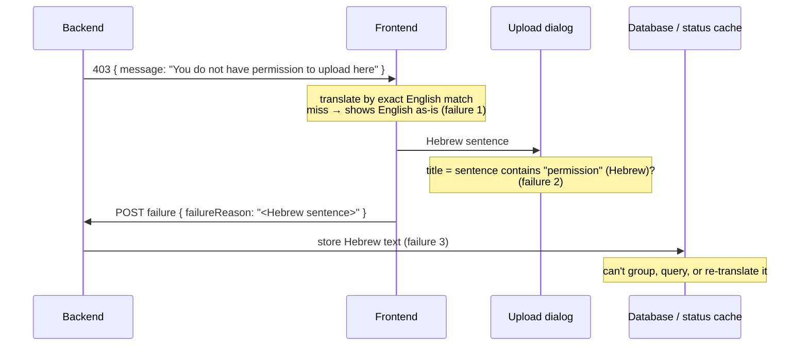

# Error handling that depends on message text instead of error codes

## TL;DR

When an app represents an error only as a sentence of text, every part of the system that needs to know *which* error happened has to recognize it by its wording. Translation, UI logic, stored data and progress tracking then break silently whenever someone rewords a sentence, and the compiler can't warn you. The fix is to give every error a **stable identifier** (an error code, plus parameters) that code and data use, and to turn that code into a human sentence only at the edge, right before a person reads it.

## The problem

A web app has an ASP.NET Core backend and a single-page frontend. Its users read the UI in Hebrew. Errors are created as **text, not data**, and that text is passed around and used in logic:

1. **English leaks to users.** The backend returns English messages. The frontend translates them with a lookup table keyed by the **exact English sentence**. When a backend developer rewords a message ("File is too large" becomes "The file is too large"), the lookup misses and the raw English sentence reaches Hebrew users. Nothing fails, nothing logs a warning.
2. **Logic depends on wording.** The file upload dialog picks its title by searching the translated Hebrew message for the Hebrew word for "permission". Changing a sentence, even fixing a typo, can silently change behavior.
3. **The backend stores translated text.** When an upload fails in the browser, the frontend sends its translated Hebrew sentence back to the server as a `failureReason`. That Hebrew text ends up in the database and in a status cache.
4. **The backend does it too.** A background job's progress reporter detects which stage the job is in by matching on message text. Part of that matching is already dead code: a message it looks for is no longer produced, and no tool noticed.

**Root cause:** there is no stable identifier for an error, only its wording.

The symptoms are typical: an English sentence appears in a Hebrew UI after a backend change; a dialog shows the wrong title; reports grouped by failure reason show near-duplicates ("Permission denied" vs "Permission denied." in Hebrew); and a refactor "that only changed wording" causes a bug.

## Why it happens

### 1. A message has two jobs, and text can only do one well

Every error has two audiences:

- **Code and data** need to know *which* error it is, so they can branch, count, store, and translate it. This needs an **identifier**: something stable that never changes once published.
- **People** need a clear sentence in their language. This needs **presentation**: wording that can be improved, translated, and changed freely.

A text-only error forces one string to do both jobs. Whoever needs the identity has to **parse the presentation** to recover it. Standards for HTTP APIs explicitly forbid this. RFC 9457 (Problem Details) says "Consumers SHOULD NOT parse the "detail" member for information" and recommends extension members for machine-readable data instead [1]. Google's API guidelines require every error to carry a machine-readable `reason`, and require any value mentioned in the message to also appear in structured `metadata`, so clients never have to parse text [2]. Microsoft's Azure guidelines make error codes part of the API contract, and add extra fields "so customers don't resort to parsing your error message" [3].

### 2. Follow one error through the system

The sequence below shows one permission error on its way through the app. Each arrow that matches or copies text is a place where a wording change breaks something.



Each step takes the previous step's **output for humans** and treats it as **input for code**. The error's identity is never written down, so it has to be rediscovered by matching at every hop. Each rediscovery is a guess that can be wrong.

### 3. Strings are invisible to the compiler

This style is called **stringly typed** code: "an implementation that needlessly relies on strings" when a type would do [9]. The cost is what tools can no longer do for you:

- **Rename a C# enum member or constant:** the compiler finds every use, and "Find all references" lists them.
- **Reword a string:** the code still compiles. The lookup table, the substring check, and the progress matcher keep running, they just stop matching. You find out from a user.

That is also why failure 4 has dead code. A branch that compares against a sentence nobody produces any more looks exactly like a live branch. No analyzer can prove that a string comparison never matches.

In design terms, the frontend's lookup table and the backend's message strings have **connascence of meaning**: separate components must agree on what particular values mean [11]. That is a strong, hidden form of coupling, because nothing in either codebase shows the dependency. Replacing the shared sentence with a shared, named identifier turns it into the weaker, visible **connascence of name** [11]. The refactoring catalog name for the move is **Replace Primitive with Object** (also known as Replace Type Code with Class) [10].

### 4. Translation is a one-way, lossy step

Turning an error code into a Hebrew sentence loses information. You can't reliably get the code back, translate it into another language, or group records by it. When the translated sentence is **stored** (failure 3), every downstream consumer inherits the problem:

- Reports can't group failures by cause, because the same cause has many spellings over time.
- A wording fix in the UI doesn't fix rows already stored.
- Adding a second language means old rows stay in Hebrew forever.

Presentation leaked into the data layer. The general principle: store **what happened** (code plus parameters), and render **how to say it** at read time, for whoever is reading.

### 5. The failure mode is silent, and it fails open

When a text lookup misses, the code does the "helpful" thing and falls back to the original text. So the failure **fails open**: the user sees English, and no one is told. ASP.NET Core's `IStringLocalizer` behaves the same way by design: if a key has no translation, it returns the key itself [6], and sets `LocalizedString.ResourceNotFound` to `true` so you *can* detect it [7]. Any translation step needs an explicit decision about what a miss should do.

## Options and solutions

All options assume a typical ASP.NET Core (.NET 10) API with a separate frontend.

### Option 1: Keep matching on text, but harden it

Keep messages as the identifier, but make the matching less fragile: move every backend message into one constants class, generate the frontend's lookup table from it, and add a test that fails when a message has no translation. Replace substring checks with exact comparisons against the shared constants.

- **Grade:** 3/10. It patches the symptoms but keeps text as the identity, so every wording fix is still a breaking change.
- **Pros:** Small, incremental change. No API contract change. Catches most leaks with one test.
- **Cons:** Wording and identity are still the same thing, so fixing a typo in English requires a coordinated frontend change. Parameterized messages ("File is larger than 10 MB") can't be matched exactly at all. Stored data is still text. This is the anti-pattern with guard rails, not a fix.
- **Use when:** As a short-lived step during migration to Option 2, or in a throwaway internal tool.

### Option 2: Stable error codes plus parameters, translated by the client

Every error gets a **code** (`UPLOAD_PERMISSION_DENIED`) and optional **parameters** (`{ "maxSizeMb": 10 }`). The backend returns them in a Problem Details response as extension members [1][4]. Then each consumer uses the part it needs:

- **Frontend display:** looks up the Hebrew template by code, and fills in parameters, ideally with ICU message syntax so plurals and word order are handled per language [8]. An unknown code shows a **generic** Hebrew message and logs the code, so it never shows English.
- **Frontend logic:** the upload dialog switches on the code (`code === "UPLOAD_PERMISSION_DENIED"`), never on the sentence.
- **Reported failures:** the frontend sends `{ code, args }` back as the failure reason. The server validates the code against its known list and stores the code. Hebrew text never reaches the database.
- **Backend internals:** errors are typed (an `ErrorCode` value, a custom exception with a `Code` property [5], or a result type), and the progress reporter emits a `Stage` enum instead of a sentence.

The English `title`/`detail` stays in the response for developers and logs. It's allowed to change, because no code reads it [1][2].

- **Grade:** 9/10. The default: identity becomes data, so wording changes can't break logic, storage, or translation.
- **Pros:** Fixes all four failures at the root. Wording can change freely on both sides. Codes are searchable, countable, and safe to store. Adding a language is a frontend-only change. A test can check that every code has a translation.
- **Cons:** Codes become part of your **API contract**, so renaming or removing one is a breaking change [3]. You maintain a catalog on two sides (backend codes, frontend translations) that must be kept in sync. Existing rows that store Hebrew text need a migration or a legacy column.
- **Use when:** Any app where the frontend owns the language, which is the common case for single-page apps. This fits the scenario above.

### Option 3: Stable error codes, translated by the server

Same codes and parameters as Option 2, but the backend also renders the localized sentence. It reads the user's language from `Accept-Language` (request localization middleware) and resolves the text with `IStringLocalizer` keyed by the error code [6]. The response carries both: `code` for logic, and `detail` in Hebrew for display. RFC 9457 allows `title` and `detail` to be localized through content negotiation [1].

- **Grade:** 7/10. Good when several clients must show identical text, but the client still needs its own translations for errors the server never sees.
- **Pros:** One translation catalog, in one place. Every client (web, mobile, emails, generated PDFs) shows the same wording. The frontend becomes simpler: show `detail`, branch on `code`.
- **Cons:** The frontend still needs translations for its own errors: network failures, client-side validation, an upload that fails before reaching the server. So you often end up with two catalogs anyway. A missing server translation falls back to the key [6] unless you check `ResourceNotFound` [7]. Every error response now depends on request culture, which complicates caching and logs. Stored data must still use the code, not the rendered text.
- **Use when:** Several different clients consume the API, or the server itself produces user-facing text (emails, notifications, exports).

### Option 4: Use the RFC 9457 `type` URI as the only identifier

Problem Details already has an identifier field. RFC 9457 says consumers "MUST use the "type" URI ... as the problem type's primary identifier" [1]. Instead of adding a `code` extension, set `type` to a URI such as `https://example.com/problems/upload-permission-denied`, and have clients switch on it. The URI can point to a documentation page for that error.

- **Grade:** 6/10. Standards-pure and self-documenting, but URIs are awkward as switch keys and database values.
- **Pros:** No custom field; any Problem Details–aware client or tool understands it. The identifier doubles as a link to documentation.
- **Cons:** Long URIs are clumsy in `switch` statements, translation files, and database columns, and changing the domain or path changes every identifier. One `type` usually names a category, so finer-grained cases still need extra fields. Many teams set `type` **and** a short `code` extension, which is really Option 2.
- **Use when:** A public API where Problem Details compliance and linked documentation matter more than convenience. Combine with a `code` extension when clients need short keys.

### Recommendation

| Option | Grade | Best for |
| --- | --- | --- |
| 2. Error codes + parameters, client translates | 9/10 | SPAs where the frontend owns the UI language |
| 3. Error codes, server translates | 7/10 | Several clients, or server-generated user-facing text |
| 4. `type` URI as identifier | 6/10 | Public APIs that value strict RFC 9457 compliance |
| 1. Harden text matching | 3/10 | A temporary step during migration only |

Start with **Option 2**. Put the code and parameters in Problem Details extension members, set `type` as well if you like (Option 4's benefit for free), keep English `detail` for developers, and translate on the frontend with a generic fallback for unknown codes. Inside the backend, give the progress reporter a typed `Stage` enum and delete the text matching, including the dead branch.

Migrate in small steps instead of all at once:
1. Add `code` to every error response, next to the existing message.
2. Switch the frontend's translation and the upload dialog's logic to `code`, keeping the old text lookup only as a fallback.
3. Change the failure-reason endpoint to accept a code, and add a `failure_code` column. Backfill old rows where the Hebrew text maps cleanly to a code; leave the rest as `UNKNOWN_LEGACY`.
4. Remove the text lookup and the `failureReason` text field.

What it costs: a catalog of codes that is now a public contract, so you can add codes freely but must treat renames and removals as breaking changes [3]; a sync check between backend codes and frontend translations; and a data migration for stored text. What you give up compared with Option 3: if a second client appears, it needs its own copy of the translations.

## What the industry does

- **A machine-readable code next to a human message** is the common design in large public APIs. Google requires an `ErrorInfo` with a stable `reason` (UPPER_SNAKE_CASE) and a `domain`, and lets the message text change over time [2]. Azure requires a `code` field and an `x-ms-error-code` header, and documents codes as part of the contract [3].
- **Problem Details (RFC 9457)** is the standard JSON error shape for HTTP APIs, and ASP.NET Core produces it natively through `AddProblemDetails`, `IProblemDetailsService`, and `IExceptionHandler` [1][4].
- **Parameters travel as data, not baked into text.** Google requires every value in the message to also be in `metadata` [2]. Frontend i18n libraries use ICU message syntax to place parameters and handle plurals per language [8].
- **Exceptions carry extra properties for programmatic use.** .NET's exception guidance says to add properties beyond the message when code needs the information, as `FileNotFoundException.FileName` does, and to treat `Message` as text for people, localized from resources [5].
- **Expected failures as values.** For validation and other expected errors, many teams collect errors in a result or **Notification** object instead of throwing, which makes them structured data by design [12].

**Anti-patterns:**
- Using `Exception.Message`, a response's `message`/`detail`, or a translated sentence in an `if`, `switch`, or `Contains` check.
- Translation tables keyed by English sentences.
- Storing rendered, localized text as the record of what happened.
- A lookup miss that falls back to showing the untranslated text without logging it.
- Accepting free-text error reasons from the client and storing them as-is.

## Concepts to look up

- **Stringly typed:** using strings where a type (enum, class, record) would let the compiler check correctness.
- **Primitive obsession / Replace Primitive with Object:** the smell of modeling domain concepts with raw strings or ints, and the refactoring that fixes it.
- **Connascence (of name, of meaning):** a way to measure coupling by what two components must agree on; agreeing on a name is weaker and safer than agreeing on the meaning of a value.
- **Problem Details (RFC 9457):** the standard JSON format for HTTP API errors, with `type`, `title`, `status`, `detail`, `instance`, and extension members.
- **Error code catalog:** the documented list of stable codes an API can return, treated as part of the API contract.
- **API contract / breaking change:** what clients may rely on, and changes that would break them.
- **Internationalization (i18n) and localization (l10n):** making software translatable, and then translating it.
- **ICU MessageFormat:** a message syntax for parameters, plurals and selection that translators can edit safely.
- **Content negotiation (`Accept-Language`):** the client telling the server which language it wants.
- **Separation of concerns / presentation layer:** keeping how something is displayed apart from what it means.
- **Fail open vs fail closed (fail safe):** whether a failure falls back to a permissive or a safe default; for translations, a generic message is the safe default.
- **Notification pattern / result pattern:** returning collected errors as values instead of throwing exceptions.

## Example

The code targets .NET 10 (LTS) with ASP.NET Core minimal APIs.

**Before: identity lives in the text.** These snippets show the four failures in their backend and frontend shapes.

```csharp
// Backend: the only thing the client gets is a sentence.
return Results.Problem(statusCode: 403, detail: "You do not have permission to upload here");

// Backend: progress stage recovered from a message (failure 4).
if (message.StartsWith("Validating")) stage = "validation";
else if (message.Contains("Saving rows")) stage = "save";   // dead: nothing says "Saving rows" any more
```

```text
// Frontend, pseudocode
translations = { "You do not have permission to upload here": "<Hebrew sentence>" }
text = translations[problem.detail] ?? problem.detail          // miss → English shown (failure 1)
title = text.includes("<Hebrew word for 'permission'>") ? ... // logic on wording (failure 2)
post("/uploads/failed", { failureReason: text })              // Hebrew stored (failure 3)
```

**After: a typed error code with an explicit wire value.** A record with named instances is the **Replace Primitive with Object** move [10]. The C# name and the wire value are separate, so renaming the field can't change the contract.

```csharp
public sealed record ErrorCode(string Value)
{
    public static readonly ErrorCode UploadPermissionDenied = new("UPLOAD_PERMISSION_DENIED");
    public static readonly ErrorCode UploadTooLarge         = new("UPLOAD_TOO_LARGE");
    public static readonly ErrorCode Unknown                = new("UNKNOWN");

    public static readonly IReadOnlyList<ErrorCode> All = [UploadPermissionDenied, UploadTooLarge, Unknown];

    public static bool TryParse(string? value, out ErrorCode code)
    {
        code = All.FirstOrDefault(c => c.Value == value) ?? Unknown;
        return code != Unknown || value == Unknown.Value;
    }
}

// The exception carries the code and parameters as data; Message is for logs only [5].
public sealed class AppException(ErrorCode code, int status, IReadOnlyDictionary<string, object?>? args = null)
    : Exception(code.Value)
{
    public ErrorCode Code { get; } = code;
    public int Status { get; } = status;
    public IReadOnlyDictionary<string, object?> Args { get; } = args ?? new Dictionary<string, object?>();
}
```

**Turn it into Problem Details in one place** with an `IExceptionHandler` [4]. The code and parameters go into extension members; English `detail` is for developers [1].

```csharp
internal sealed class AppExceptionHandler(IProblemDetailsService problemDetails) : IExceptionHandler
{
    public async ValueTask<bool> TryHandleAsync(HttpContext http, Exception ex, CancellationToken ct)
    {
        if (ex is not AppException app) return false;      // let other handlers deal with the rest

        http.Response.StatusCode = app.Status;
        return await problemDetails.TryWriteAsync(new ProblemDetailsContext
        {
            HttpContext = http,
            Exception = ex,
            ProblemDetails = new ProblemDetails
            {
                Status = app.Status,
                Type = $"https://example.com/problems/{app.Code.Value.ToLowerInvariant()}", // optional, Option 4
                Title = app.Code.Value,
                Detail = "Upload rejected: the user lacks write access.", // English, for developers; may change
                Extensions =
                {
                    ["code"] = app.Code.Value,   // the stable identifier clients use
                    ["args"] = app.Args          // parameters for the translated template
                }
            }
        });
    }
}

// Program.cs
builder.Services.AddProblemDetails();
builder.Services.AddExceptionHandler<AppExceptionHandler>();
// ...
app.UseExceptionHandler();
```

**Accept a code, not a sentence, when the client reports a failure** (failure 3).

```csharp
public sealed record UploadFailure(string Code, Dictionary<string, string>? Args);

app.MapPost("/uploads/{id:guid}/failed", async (Guid id, UploadFailure body, AppDbContext db, ILogger<Program> log) =>
{
    if (!ErrorCode.TryParse(body.Code, out var code))
        log.LogWarning("Unknown failure code {Code} for upload {UploadId}", body.Code, id); // stored as UNKNOWN

    var upload = await db.Uploads.FindAsync(id);
    if (upload is null) return Results.NotFound();

    upload.FailureCode = code.Value;   // a short, queryable code instead of a translated sentence
    await db.SaveChangesAsync();
    return Results.NoContent();
});
```

**Progress stages as a type** (failure 4). The compiler now knows every stage. A `switch` expression that doesn't handle every input value gets a compiler warning [13], so leave out the catch-all `_` arm if you want a new stage to be flagged everywhere it's consumed.

```csharp
public enum ImportStage { Uploading, Validating, Saving, Completed }

public sealed record ProgressUpdate(ImportStage Stage, int Percent);

// The reporter receives the stage directly; there is nothing to parse.
await reporter.ReportAsync(new ProgressUpdate(ImportStage.Validating, 40));

// Consumers branch on the enum. No `_` arm: adding a stage produces a warning here.
static string StageKey(ImportStage stage) => stage switch
{
    ImportStage.Uploading  => "IMPORT_STAGE_UPLOADING",
    ImportStage.Validating => "IMPORT_STAGE_VALIDATING",
    ImportStage.Saving     => "IMPORT_STAGE_SAVING",
    ImportStage.Completed  => "IMPORT_STAGE_COMPLETED",
};
```

C# also warns that an enum can hold unnamed values such as `(ImportStage)42`. That warning is the price of keeping the new-stage warning; the runtime throws `SwitchExpressionException` if such a value ever arrives [13].

**On the frontend** (pseudocode), translation and logic both key on the code, with a safe fallback:

```text
messages = { UPLOAD_PERMISSION_DENIED: "<Hebrew>", UPLOAD_TOO_LARGE: "<Hebrew with {maxSizeMb}>", ... }
template = messages[problem.code]
if (!template) { logWarning("missing translation", problem.code); template = messages.GENERIC_ERROR }
text  = format(template, problem.args)                         // ICU-style placeholders [8]
title = problem.code == "UPLOAD_PERMISSION_DENIED" ? ... : ...  // logic on the code, not the text
post("/uploads/{id}/failed", { code: problem.code, args: problem.args })
```

**A test that keeps both sides in sync.** If the frontend's translation keys are exported to a JSON file in the repo, one backend test can fail the build when a code has no translation:

```csharp
[Fact]
public void Every_error_code_has_a_Hebrew_translation()
{
    var keys = JsonSerializer.Deserialize<Dictionary<string, string>>(
        File.ReadAllText("../../../../frontend/src/i18n/he/errors.json"))!.Keys;

    var missing = ErrorCode.All.Select(c => c.Value).Except(keys);
    Assert.Empty(missing);
}
```

## Check your understanding

1. A backend developer fixes a typo in an error message. In the text-matching design, what breaks, and why does nothing report it?

   <details><summary>Answer</summary>

   The frontend's lookup table is keyed by the old sentence, so the lookup misses and the fallback shows the raw English text. Any substring check on the translated text also stops matching. Nothing reports it because the code still compiles and runs: a string that doesn't match is not an error, just a different branch. That's the cost of stringly typed code [9].

   </details>

2. Why is storing the translated Hebrew sentence as the failure reason worse than storing a code, even if the UI only ever shows Hebrew?

   <details><summary>Answer</summary>

   Translation is one-way. From stored text you can't reliably group failures by cause, fix the wording of old rows, or show them in another language later. A code (plus parameters) keeps *what happened* and lets each reader render *how to say it* at read time.

   </details>

3. RFC 9457 lets servers localize `title` and `detail`. If you localize `detail` on the server (Option 3), why do you still need a `code`?

   <details><summary>Answer</summary>

   Because localized text is for people, and code must not parse it. RFC 9457 says consumers should not parse `detail` [1]. The frontend still needs a stable value to branch on, and the database still needs a stable value to store. The localized `detail` replaces only the client's translation step, not the identifier.

   </details>

4. Your frontend receives an error code it has no translation for, because the backend deployed a new code first. What should it show, and why not the English `detail`?

   <details><summary>Answer</summary>

   A generic error message in the user's language, plus a logged warning with the code so the gap gets fixed. Showing English `detail` is the original bug, failing open. A generic message fails safe: the user still learns that something went wrong, in their language.

   </details>

5. The progress reporter had a branch matching a sentence that nothing produces any more. Why could neither the compiler nor an IDE find it, and what changes when stages are an enum?

   <details><summary>Answer</summary>

   A comparison against a string literal looks the same whether or not any producer still emits that string. The link between producer and consumer exists only in their *values* (connascence of meaning [11]), which tools don't track. With an enum, producer and consumer share a *name*: removing a stage breaks the build wherever it's used, and "Find all references" shows every producer and consumer.

   </details>

## Sources

1. M. Nottingham, E. Wilde, S. Dalal, "Problem Details for HTTP APIs", RFC 9457, IETF, 2023: §1 (localization via content negotiation), §3.1.1 (`type` as primary identifier), §3.1.3 (`title`), §3.1.4 (`detail`, do not parse), §3.2 (extension members). https://www.rfc-editor.org/rfc/rfc9457.html
2. Google, "AIP-193: Errors", API Improvement Proposals: `ErrorInfo` (`reason`, `domain`, `metadata`), message stability, `LocalizedMessage`. https://google.aip.dev/193
3. Microsoft, "Microsoft Azure REST API Guidelines", § "Handling Errors" (`code`, `x-ms-error-code`, codes as part of the API contract). https://github.com/microsoft/api-guidelines/blob/vNext/azure/Guidelines.md
4. Microsoft, "Handle errors in ASP.NET Core APIs", ASP.NET Core 10 docs: Problem Details, `AddProblemDetails`, `IProblemDetailsService`, `IExceptionHandler`. https://learn.microsoft.com/en-us/aspnet/core/fundamentals/error-handling-api
5. Microsoft, "Best practices for exceptions", .NET docs: § "Include a localized string message", § "Provide more properties as needed". https://learn.microsoft.com/en-us/dotnet/standard/exceptions/best-practices-for-exceptions
6. Microsoft, "Make an ASP.NET Core app's content localizable", § "IStringLocalizer" (a missing key returns the key). https://learn.microsoft.com/en-us/aspnet/core/fundamentals/localization/make-content-localizable
7. Microsoft, "LocalizedString.ResourceNotFound Property", .NET API reference. https://learn.microsoft.com/en-us/dotnet/api/microsoft.extensions.localization.localizedstring.resourcenotfound
8. FormatJS, "Message syntax" (ICU message syntax: arguments, `plural`, `select`). https://formatjs.github.io/docs/core-concepts/icu-syntax/
9. Jeff Atwood, "New Programming Jargon", Coding Horror (blog), 2012, entry "Stringly Typed". Community source. https://blog.codinghorror.com/new-programming-jargon/
10. Martin Fowler, "Replace Primitive with Object", Refactoring catalog (from *Refactoring*, 2nd edition, Addison-Wesley, 2018). https://refactoring.com/catalog/replacePrimitiveWithObject.html
11. connascence.io, "Connascence of Meaning" (community reference site). https://connascence.io/meaning.html
12. Martin Fowler, "Replacing Throwing Exceptions with Notification in Validation", martinfowler.com, 2014. https://martinfowler.com/articles/replaceThrowWithNotification.html
13. Microsoft, "switch expression", C# language reference, § "Nonexhaustive switch expressions". https://learn.microsoft.com/en-us/dotnet/csharp/language-reference/operators/switch-expression

## Related

- [SOLID: what the five principles mean and when they help or hurt](../best-practices/principles/solid-principles.md): the same idea at the level of code design. Depending on a stable, named contract instead of a hidden detail (here, message wording) is what the Dependency Inversion Principle asks for.
