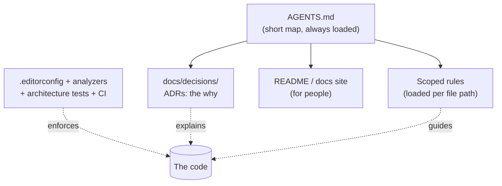

# Keeping a project's decisions and conventions findable by AI assistants and new developers

## TL;DR

A codebase stays consistent only if two things are easy to find: **what the conventions are** and **why past decisions were made**. People and AI assistants both start every task with no memory of either, so the answer is to write them down in the repository, in small files that are cheap to load. The usual recipe is a short hand-written **AGENTS.md** that acts as a map, one **Architecture Decision Record (ADR)** per significant decision for the "why", and **linters and tests** that enforce the rules a machine can check. Heavier layers (per-feature specs, a full documentation site) are worth adding only when the project is large enough to need them.

## The problem

A developer has been building an ASP.NET Core API for a few months. They now use an AI coding assistant for new features, and a second developer is about to join. Three things keep going wrong:

1. **The assistant reinvents decisions.** It adds a new date library even though the project already standardized on one. It returns errors in a different shape than the other endpoints. It undoes an earlier choice because it can't see why that choice was made.
2. **Style drifts.** Two features done a week apart use different folder layouts, naming, and test styles.
3. **The newcomer asks the same questions.** "Why do we use this pattern here?" has an answer, but only in someone's head or in a chat thread from three months ago.

The question: **how do you structure a repository so that conventions and past decisions are easy for an AI (and a new person) to find, and stay consistent over time?**

## Why it happens

### 1. Every session starts from zero

An AI coding assistant has no memory between sessions. Claude Code's documentation says each session begins with a fresh context window, and it offers two carry-over mechanisms: instruction files you write, and notes the tool writes itself [2]. Other tools work the same way. A new developer is in a similar position on day one. In both cases, whatever isn't in the repository (or loadable from it) effectively doesn't exist.

### 2. Decisions leave no trace unless you record them

Code shows *what* was chosen, almost never *why* or *what was rejected*. Michael Nygard's 2011 argument for ADRs was that large specification documents go stale and rarely get read, while small modular records have a better chance of staying current, and the main goal is to preserve reasoning so future developers don't have to accept or reverse decisions blindly [5]. Microsoft's architecture guidance puts the failure mode plainly: a decision made but never recorded is likely forgotten, which leads to repeated debates or later changes that unknowingly contradict the original intent [6]. An AI assistant fixing a bug takes the same path a rushed human would: it picks whatever fits the code in front of it.

### 3. More context is not automatically better

The tempting fix is to write a huge instruction file describing everything. The evidence says otherwise. A 2026 study by Gloaguen et al. tested context files such as AGENTS.md on coding agents and found that they did not generally raise task success, raised inference cost by over 20% on average, and that repository overviews (popular and recommended by model providers) did not help; the files were most useful for non-standard practices the model couldn't guess [3]. Anthropic's docs give the same practical advice: target under about 200 lines per CLAUDE.md, because longer files consume more context and reduce adherence [2]. And instructions are only context. The docs say that to block an action regardless of what the model decides, you need a hook, not a sentence in a file [2].

So the design goal is **progressive disclosure** (also called context engineering): a small always-loaded entry point, with details in separate files that are read only when relevant.

### 4. Prose can't enforce; tools can

A rule written in Markdown can be ignored or forgotten. A rule checked by the compiler or a test can't. This is the core distinction between **documentation** (explains, guides) and **enforcement** (blocks). A good setup uses both, and puts each rule in the cheapest layer that can carry it.



## Options and solutions

Grades are for a typical ASP.NET Core project with a small team (one to five developers) using AI assistants. The options are layers, not rivals: the recommendation at the end combines several.

### Option 1: AGENTS.md as a short "router" file

A plain Markdown file at the repository root with build and test commands, the few conventions the model can't infer, and links to deeper documents. [AGENTS.md](https://agents.md/) is the cross-tool convention: it has no required fields, agents read the closest file in the directory tree, and an explicit user prompt overrides it [1]. GitHub Copilot and Cursor both read it too [10][11]. Claude Code reads AGENTS.md by itself only when no CLAUDE.md exists above your working directory; if both exist, only CLAUDE.md is read unless CLAUDE.md imports AGENTS.md [2]. The documented pattern is a one-line `CLAUDE.md` containing `@AGENTS.md`.

- **Grade:** 8/10 as a foundation, 3/10 on its own. It is the entry point everything else hangs from, but it records instructions, not reasons.
- **Pros:** One file, works across tools (a single source of truth), cheap to write.
- **Cons:** It grows into a dumping ground. Per the study above, bloat and auto-generated overviews cost money without helping [3]. Nothing enforces it [2].
- **Use when:** Always. Keep it under roughly 200 lines, hand-written, and focused on what is non-obvious.

### Option 2: Architecture Decision Records (ADRs) with the MADR template

One short Markdown file per significant decision, for example `docs/decisions/0007-use-problem-details-for-errors.md`. **MADR** (Markdown Architectural Decision Records) has Context and Problem Statement, Decision Drivers (optional), Considered Options, Decision Outcome (with Consequences), and optional pros and cons per option, with optional front matter for status and date. The MADR project suggests a `docs/decisions` folder and `NNNN-title-with-dashes.md` naming [4]. Nygard's original version uses Title, Context, Decision, Status, Consequences, one to two pages each, numbered sequentially, never reusing a number [5].

The rules that make ADRs work: the log is **append-only**. You don't edit an accepted record; if a decision changes, you write a new record that supersedes the old one and link the two [5][6]. Microsoft suggests recording only choices that affect structure, key quality attributes, or are hard to reverse, and noting the confidence level when a decision was made with low confidence [6].

- **Grade:** 9/10. It is the only option aimed squarely at "why was this decided?", and it is also good onboarding reading.
- **Pros:** Standard format, searchable, versioned with the code. Records rejected alternatives, which stops the assistant (and people) from re-proposing them. Your own habit of writing options and tradeoffs maps directly onto MADR's Considered Options.
- **Cons:** It records but does not enforce. An assistant must be told to read it (put a line in AGENTS.md), and an agent won't automatically know to write one. It needs the discipline to write a record when a real decision is made. Reports of measured speedups from giving agents decision records exist, but I could only find them second-hand, so treat them as **[unverified]**.
- **Use when:** Any project that will live more than a few weeks or have more than one contributor (including an AI).

### Option 3: Spec-driven development (GitHub Spec Kit and similar)

A workflow where each feature goes through written stages before code. In GitHub's [Spec Kit](https://github.com/github/spec-kit) you run commands in your agent: `/speckit-constitution` once per project to set principles, then per feature `/speckit-specify`, `/speckit-plan`, `/speckit-tasks`, `/speckit-implement`, and `/speckit-converge` to check the result [7]. The "constitution" is a standing set of non-negotiable principles that later steps refer to.

- **Grade:** 6/10 now. It gives a strong paper trail per feature, but the process cost is high for a solo developer or small features.
- **Pros:** Consistent process, every feature leaves a spec and plan behind, and it works with several agents.
- **Cons:** Heavy ceremony and extra tooling and folders. It documents *features*, while ADRs document *cross-cutting decisions*; you still need both. It is a young toolkit, so conventions may change.
- **Use when:** Larger features with several people reviewing, or when you want every change to start from a reviewed written spec.

### Option 4: Scoped, modular rule files

Split conventions into small files that load only when relevant:

| Tool | Location | Scoping |
| --- | --- | --- |
| Claude Code | `.claude/rules/*.md` | optional `paths:` frontmatter [2] |
| Cursor | `.cursor/rules/*.mdc` | `globs`, `alwaysApply`, or the agent decides from a `description` [10] |
| GitHub Copilot | `.github/instructions/*.instructions.md` | `applyTo` glob [11] |

For a .NET project that might be one rule file for controllers/endpoints, one for EF Core migrations, one for tests.

- **Grade:** 7/10. It is the practical way to keep AGENTS.md small once conventions multiply.
- **Pros:** Only the relevant rules cost context. Each file covers one topic, which makes conflicting rules easier to spot.
- **Cons:** Formats differ per tool (lock-in, or duplication if you support several). Anthropic warns that contradictory instructions can be followed arbitrarily, so these files need periodic cleanup [2]. They are still guidance, not enforcement.
- **Use when:** AGENTS.md is approaching ~200 lines, or different parts of the codebase have clearly different rules.

### Option 5: Docs-as-code with a taxonomy (Diátaxis, plus an architecture overview)

Keep human documentation as Markdown in the repo and organize it by reader need. **Diátaxis** names four types: tutorials, how-to guides, technical reference, and explanation [14]. Add a short architecture overview (a C4 or arc42 style context and container diagram) so a newcomer sees the shape of the system before reading code. Some teams also publish an `llms.txt` index for AI tools; whether that format lasts is unsettled, and I saw one team drop it **[unverified]**.

- **Grade:** 7/10 for onboarding people, 5/10 as the mechanism for AI.
- **Pros:** Best reading path for a new developer. The folder structure itself enforces a consistent layout.
- **Cons:** The most maintenance, and docs drift from the code. Repository overviews specifically were not found to help AI agents [3], so don't expect AI to benefit from a long architecture document.
- **Use when:** The project has several contributors or will be handed over.

### Option 6: Memory Bank or steering files

Files that track *current state*, not just rules. Cline's **Memory Bank** is a set of Markdown files (`projectbrief.md`, `productContext.md`, `activeContext.md`, `systemPatterns.md`, `techContext.md`, `progress.md`) that the agent reads at the start of each session and that you ask it to keep updated [8]. Kiro's **steering files** live in `.kiro/steering/`, with inclusion modes (always, fileMatch, manual, auto) and generated `product.md`, `tech.md`, `structure.md` files [9].

- **Grade:** 5/10. Useful for tracking "what are we in the middle of", but it duplicates ADRs and AGENTS.md for conventions.
- **Pros:** Captures in-progress context that no other option does.
- **Cons:** Goes stale quickly. Needs the agent (or you) to keep updating it. Auto-generated or overview-style content is what the study found unhelpful [3]. Some of the structure is specific to one tool.
- **Use when:** Long multi-session work where "where did we stop" matters, and only if you will maintain it.

### Option 7: Enforce consistency with tools, not prose

For a .NET project, the cheapest guarantee of consistent style and layout:

- **`.editorconfig` + Roslyn analyzers.** The .NET SDK ships analyzers that are on by default for projects targeting .NET 5+; `CAxxxx` rules cover quality and `IDExxxx` rules cover style. Code-style rules do not run on command-line builds by default; set `EnforceCodeStyleInBuild` to `true` and set rule severities in `.editorconfig` to make them build warnings or errors. `AnalysisMode` (for example `Recommended`) enables more rules [12].
- **Architecture tests.** Libraries such as **NetArchTest** let you write rules like "presentation types must not depend on the data layer" as ordinary unit tests, which makes layout and dependency rules fail the build when broken [13].
- **Hooks and CI.** For AI-specific enforcement, Claude Code hooks can block actions regardless of what the model decides [2], and CI can run the same build and tests on every pull request.

- **Grade:** 9/10 for style, layout and dependency rules; 0/10 for recording why.
- **Pros:** The only option that *guarantees* the rule. The AI also gets immediate, unambiguous feedback from compiler and test errors.
- **Cons:** Only works for rules a machine can check. Rules that are too strict create warning noise and suppression habits.
- **Use when:** Always, for every rule you can express mechanically. Moving a rule from prose into a check is usually an upgrade.

### Where do project-specific or sensitive decisions go?

An ADR folder in a public repository is public. Decisions that mention a real client, internal system, credentials, or business details belong somewhere that is not published: a separate private repository, or a folder that is excluded from version control (listed in `.gitignore`, or kept outside the repository). The usual trade-off is that an untracked folder isn't backed up or shared by git, and an AI assistant can only read it if you point it there (for example by adding the folder as an extra working directory), so keep a short tracked note saying such a folder exists and how to get it. Never put secrets in an ADR at all, tracked or not; reference where they live instead (secret manager, environment variable name).

### Recommendation

| Option | Grade | Best for |
| --- | --- | --- |
| 2. ADRs (MADR) | 9/10 | Recording the "why" and rejected alternatives |
| 7. Tooling enforcement | 9/10 | Style, layout and dependency rules |
| 1. AGENTS.md as router | 8/10 | Entry point for AI and humans |
| 4. Scoped rule files | 7/10 | Keeping AGENTS.md small as conventions grow |
| 5. Docs-as-code + Diátaxis | 7/10 | Onboarding several people |
| 3. Spec-driven development | 6/10 | Large, reviewed feature work |
| 6. Memory Bank / steering | 5/10 | Tracking in-progress state across sessions |

**Start with 1 + 2 + 7**, and add 4 when AGENTS.md outgrows ~200 lines. Concretely:

- AGENTS.md: commands, the handful of non-obvious conventions, and the line "read `docs/decisions/` before changing architecture; write a new ADR when you make a significant decision."
- `docs/decisions/`: MADR records, append-only.
- `.editorconfig`, analyzers with `EnforceCodeStyleInBuild`, and a small architecture test project.

What you give up: some up-front discipline (writing an ADR each time), and no per-feature spec trail (Option 3) or progress tracking (Option 6). Both can be added later without redoing anything, because the foundation is plain Markdown and standard tooling.

## What the industry does

- **ADRs are mainstream.** Nygard's 2011 proposal [5], MADR [4], and Microsoft's Azure Well-Architected guidance [6] all describe the same append-only log of decisions kept next to the code.
- **Docs-as-code.** Documentation lives in the repo, is reviewed in pull requests, and changes with the code.
- **A shared instruction file.** The industry is converging on AGENTS.md so one file serves many tools [1]; tools still keep their own scoped formats [2][9][10][11].
- **Rules as code.** **Fitness functions** (automated checks that an architectural characteristic still holds) are implemented with architecture-test libraries like NetArchTest [13].

Anti-patterns to avoid:

- **Auto-generated mega-context files.** Generated overviews were found not to help agents and raised cost [3].
- **Editing old ADRs.** Rewriting history destroys the reason you kept the log. Supersede instead [5][6].
- **Instruction bloat and contradictions.** Longer files reduce adherence and conflicting rules may be picked arbitrarily [2].
- **Treating instructions as enforcement.** If it must never happen, make it a check or a hook [2].
- **Duplicating rules across tool-specific files.** They drift apart. Keep one source and import it.
- **Writing an ADR for everything.** Record structural, hard-to-reverse choices [6]; a naming tweak doesn't need one.

## Concepts to look up

- **Architecture Decision Record (ADR):** a short, immutable document capturing one decision, its context, the options considered, and the consequences.
- **MADR:** a Markdown ADR template that includes considered options and pros and cons.
- **Supersede (ADR status):** replacing a decision with a new record while keeping the old one for history.
- **AGENTS.md:** an open, plain-Markdown convention for briefing coding agents.
- **Context engineering / progressive disclosure:** giving a model a small starting context and letting it load more on demand.
- **Docs-as-code:** treating documentation like source code (in the repo, versioned, reviewed).
- **Diátaxis:** a framework that sorts docs into tutorials, how-to guides, reference and explanation.
- **Spec-driven development:** writing and reviewing a specification before generating code.
- **Fitness function / architecture test:** an automated check that an architectural rule still holds.
- **Single source of truth:** keeping each fact in exactly one place.

## Example

A minimal setup for a .NET 10 (LTS) ASP.NET Core solution.

`AGENTS.md` (hand-written, short):

```markdown
# AGENTS.md

## Commands
- Build: `dotnet build`
- Test: `dotnet test`

## Conventions the compiler can't enforce
- Endpoints return Problem Details with a stable error code (see ADR 0003).
- New dependencies need an ADR first.

## Decisions
Read `docs/decisions/` before changing architecture. When you make a significant
decision, add the next numbered ADR using `docs/decisions/template.md`.
```

`CLAUDE.md` (so Claude Code picks up the same file, as documented in [2]):

```markdown
@AGENTS.md
```

`docs/decisions/0003-use-problem-details-for-errors.md` (MADR-style):

```markdown
---
status: accepted
date: 2026-11-12
---

# Use Problem Details with stable error codes for API errors

## Context and Problem Statement
Clients parse error message text, which breaks when messages change or are translated.

## Considered Options
* Plain message strings
* Problem Details (RFC 9457) with a stable `code` extension
* A custom error envelope

## Decision Outcome
Chosen: Problem Details with a `code` extension, because it is a standard format
and gives clients something stable to switch on.

### Consequences
* Good: one error shape across endpoints.
* Bad: every endpoint must map exceptions to codes.
```

`.editorconfig` plus project properties to turn style rules into build errors [12]:

```xml
<!-- Directory.Build.props -->
<Project>
  <PropertyGroup>
    <EnforceCodeStyleInBuild>true</EnforceCodeStyleInBuild>
    <AnalysisMode>Recommended</AnalysisMode>
  </PropertyGroup>
</Project>
```

```ini
# .editorconfig
[*.cs]
# IDE0040: accessibility modifiers required, enforced at build time
dotnet_diagnostic.IDE0040.severity = error
```

An architecture test (NetArchTest, xUnit) that fails the build if controllers reach into the data layer [13]:

```csharp
using NetArchTest.Rules;
using Xunit;

public class ArchitectureTests
{
    [Fact]
    public void Controllers_do_not_depend_on_the_data_layer()
    {
        var result = Types.InAssembly(typeof(Program).Assembly)
            .That().ResideInNamespace("MyShop.Api.Controllers")
            .ShouldNot().HaveDependencyOn("MyShop.Data")   // the rule, enforced by the build
            .GetResult();

        Assert.True(result.IsSuccessful);
    }
}
```

The ADR explains *why*; the `.editorconfig` and the test make sure the rule is *kept*.

## Check your understanding

1. Why is an AGENTS.md that lists every folder and file in the project usually a poor idea?

   <details><summary>Answer</summary>

   The study found that repository overviews did not help agents and that context files raised inference cost [3], and Anthropic advises keeping instruction files short because long files reduce adherence [2]. Agents can already list directories themselves; the file's value is in information they can't infer, such as non-standard conventions and pointers to decisions.

   </details>

2. A team changes its mind about a decision recorded in an ADR. What should they do with the old record, and why?

   <details><summary>Answer</summary>

   Keep it, mark its status as superseded, and write a new ADR that links to it [5][6]. The history of why direction changed is part of what the log is for; editing the old record would hide it.

   </details>

3. A rule says "controllers must not call the database directly". Which layer should carry it, and why?

   <details><summary>Answer</summary>

   An architecture test (Option 7). It's a mechanical dependency rule, so a test can fail the build when it's broken, while a sentence in AGENTS.md is only context that can be ignored [2][13]. The "why" behind the rule can still go in an ADR.

   </details>

4. When would you move conventions out of AGENTS.md into scoped rule files?

   <details><summary>Answer</summary>

   When the file approaches roughly 200 lines or the rules apply to only part of the codebase (for example only test projects). Scoped files load only when matching files are involved, so they cost context only when relevant [2].

   </details>

5. Why can't an ADR folder alone guarantee an AI assistant follows past decisions?

   <details><summary>Answer</summary>

   ADRs record decisions but don't enforce them, and the assistant only knows to read them if its instructions say so (for example in AGENTS.md). For decisions that can be checked mechanically, pair the ADR with a lint rule or test.

   </details>

## Sources

1. AGENTS.md project, "AGENTS.md: a simple, open format for guiding coding agents". https://agents.md/
2. Anthropic, "How Claude remembers your project", Claude Code documentation. https://code.claude.com/docs/en/memory
3. Thibaud Gloaguen, Niels Mündler-Sasahara, Mark Niklas Müller, Veselin Raychev, Martin Vechev, "Evaluating AGENTS.md: Are Repository-Level Context Files Helpful for Coding Agents?", arXiv:2602.11988 (2026). https://arxiv.org/abs/2602.11988
4. MADR project, "Markdown Architectural Decision Records". https://adr.github.io/madr/
5. Michael Nygard, "Documenting Architecture Decisions", Cognitect blog, 15 Nov 2011. https://cognitect.com/blog/2011/11/15/documenting-architecture-decisions
6. Microsoft, "Maintain an architecture decision record (ADR)", Azure Well-Architected Framework, Microsoft Learn. https://learn.microsoft.com/en-us/azure/well-architected/architect-role/architecture-decision-record
7. GitHub, "Spec Kit" repository. https://github.com/github/spec-kit
8. Cline, "Memory Bank", Cline documentation. https://docs.cline.bot/customization/memory-bank
9. Kiro, "Steering", Kiro documentation. https://kiro.dev/docs/steering/
10. Cursor, "Rules", Cursor documentation. https://cursor.com/docs/context/rules
11. GitHub, "Adding repository custom instructions for GitHub Copilot", GitHub Docs. https://docs.github.com/en/copilot/how-tos/configure-custom-instructions/add-repository-instructions
12. Microsoft, "Code analysis in .NET", Microsoft Learn. https://learn.microsoft.com/en-us/dotnet/fundamentals/code-analysis/overview
13. Ben Morris, "NetArchTest" repository (README). https://github.com/BenMorris/NetArchTest
14. Daniele Procida, "Diátaxis". https://diataxis.fr/

**[unverified] claims:**

- That giving agents decision records measurably speeds up their work comes from a vendor blog citing a preprint I could not locate; I did not use any figure.
- That the `llms.txt` format may not last, and that one team dropped it, comes from a single third-party project record that I did not read in full.
- Source 3: I read only the abstract, not the full paper. The summary in this entry is limited to what the abstract states.

## Related

- [Error handling that depends on message text instead of error codes](../architecture/error-handling-by-message-text.md): a good example of a decision worth recording as an ADR, since it changes how every endpoint reports errors.
- [Changing a contract in an established project without breaking consumers](../architecture/changing-contracts-in-an-established-project.md): the deprecation policy and removal date for an old contract are a decision worth recording as an ADR.
- [SOLID: what the five principles mean and when they help or hurt](principles/solid-principles.md): principles like these are the kind of convention an AGENTS.md or ADR should state explicitly, with the reason and when to bend them.
