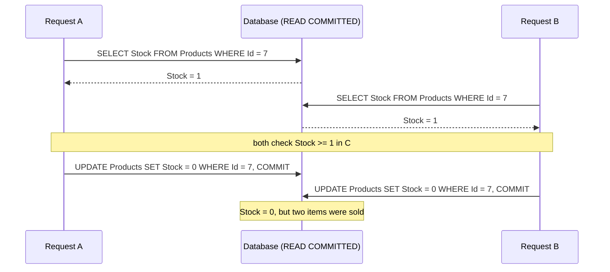
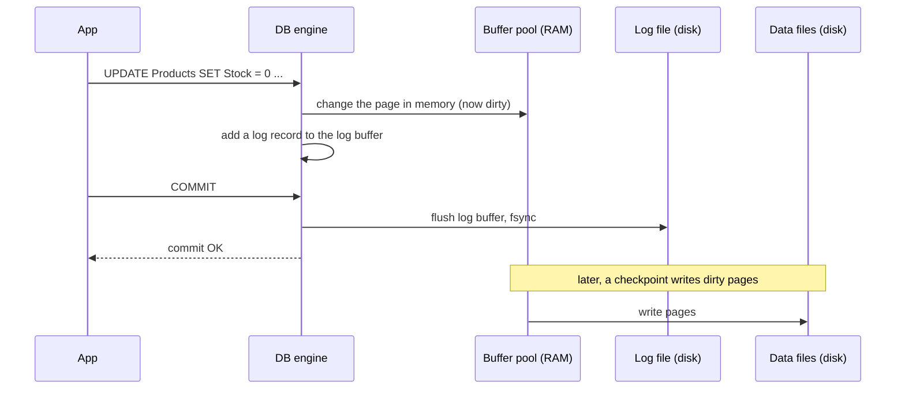

# ACID: what a database transaction actually guarantees

## TL;DR

ACID stands for **atomicity, consistency, isolation and durability**, the four properties a database transaction promises. Atomicity and durability are strong, mechanical guarantees that come from the transaction log. Consistency is mostly **your** job: the database only enforces the constraints you declared. Isolation is the letter that surprises people. SQL Server and PostgreSQL both default to READ COMMITTED, which is much weaker than "transactions run one at a time", so two concurrent requests can still lose an update. ACID also covers **one database**, not a database plus a cache plus a message broker. To keep data correct under concurrency, use atomic `UPDATE ... WHERE` statements, optimistic concurrency tokens, or a stricter isolation level with retries.

## The problem

An ASP.NET Core shop has a "reserve one item" endpoint. It loads the product with EF Core, checks `Stock >= 1`, subtracts one in C#, and calls `SaveChangesAsync`. The developer knows `SaveChanges` runs in a transaction, and transactions are ACID, so they assume the code is safe.

Two customers press "Buy" at the same moment, and only one item is left. Both requests read `Stock = 1`, both pass the check, and both save `Stock = 0`. Two orders exist for one item, and no error was raised anywhere. A support ticket arrives a week later.

The same bug appears with account balances, seat bookings, coupon redemptions and "at least one admin must remain" rules. The developer now asks: what did ACID actually promise, if not this? And what is the right way to keep this data correct when requests run concurrently?

## Why it happens

### Where ACID comes from

Jim Gray's 1981 paper described a transaction as a state change with three properties: consistency (it obeys the rules), atomicity (all or nothing) and durability (once committed, it can't be undone) [2]. Gray implemented them with **logging and locking** [2]. In 1983, Theo Haerder and Andreas Reuter built on Gray's work, named **isolation** as a separate fourth property, and coined the acronym: they called transaction support "the ACID test" of a database system [1]. Their paper is about **recovery** after failures, so atomicity and durability get most of its attention [1].

Each letter is a separate mechanism. Taking them one at a time shows what each one really guarantees.

### A: Atomicity, all or nothing, via the log

Atomicity means a transaction either applies all of its changes or none of them, and the client knows which of the two happened [1]. The database achieves this with a **transaction log** [2][10]:

1. Before changing a data page, the database writes a log record. The record holds the **before image** (old value) and the **after image** (new value) of the change [10].
2. If the transaction fails or calls `ROLLBACK`, the database applies the before images in reverse order. This is **undo** [6][10].
3. If the server crashes, recovery on restart **redoes** committed changes that hadn't reached the data files yet, and **undoes** changes from transactions that never committed [10].

Undo is needed because databases may write uncommitted ("dirty") pages to disk to free memory. Haerder and Reuter call this policy **STEAL** [1]. The rule that makes it safe is **write-ahead logging (WAL)**: the undo record must reach the log before the changed page reaches the data file [1][10].

Atomicity is about **failures**, not concurrency. It says nothing about what other transactions see while yours runs. That's isolation.

### C: Consistency, your invariants, not the database's

In the original definition, a transaction that commits "preserves the consistency of the database", and Haerder and Reuter add that a successful transaction **by definition** commits only legal results [1]. Read carefully, the database is **assuming** your transaction logic is correct. It can't know your business rules.

What the database does enforce is what you **declared**: `NOT NULL`, `UNIQUE`, foreign keys, `CHECK` constraints. A `CHECK (Stock >= 0)` constraint would have turned the double-booking above into an error. A rule such as "an order's total equals the sum of its lines" or "at least one admin remains" lives in your code, and the database will commit a violation of it without complaint.

Kleppmann makes this point in DDIA: atomicity, isolation and durability are properties of the database, while consistency is a property of the application, which relies on the database's A and I to achieve it [5] **[unverified]**.

### I: Isolation, weaker than you think

The ideal is **serializability**: concurrent transactions produce the same result as if they had run one after another. Haerder and Reuter required that events inside a transaction be hidden from concurrent transactions [1]. Real databases offer several **isolation levels**, and the default is not serializable:

- **SQL Server** defaults to READ COMMITTED [7]. With the database option `READ_COMMITTED_SNAPSHOT` OFF (the SQL Server default), reads take shared locks that are released right after each row or statement. With it ON (the Azure SQL Database default), each **statement** reads a snapshot of committed data, using row versions instead of locks. This is **RCSI**, read committed snapshot isolation [7][9].
- **PostgreSQL** defaults to Read Committed, where each statement sees data committed before that statement began [11].

Either way, data can change **between two statements of your transaction**. The concurrency problems that isolation levels allow or prevent have names:

| Anomaly | What happens |
| --- | --- |
| **Dirty read** | You read another transaction's uncommitted change, which may later roll back [6]. |
| **Non-repeatable read** (fuzzy read) | You read the same row twice and get different values, because someone committed in between [6]. |
| **Phantom** | You run the same query twice and get a different **set** of rows, because someone inserted or deleted a matching row [6]. |
| **Lost update** | Two transactions read the same value, both compute a new value from it, and the second write overwrites the first [4][6]. |
| **Write skew** | Two transactions read the same data, each writes a **different** row, and together they break a rule that each one checked [4]. |

The "Buy" bug is a **lost update**, and READ COMMITTED allows it [4][20]:



Each request ran in its own ACID transaction, and each transaction was atomic and durable. Neither saw the other's uncommitted data, so there was no dirty read. The isolation level simply doesn't promise anything about a **read-modify-write cycle** that spans two statements.

**Write skew** is subtler. Suppose the rule is "at least one admin must remain". Two admins each remove their own admin role at the same time. Each transaction counts admins, sees 2, and updates **its own** row. The two writes touch different rows, so there's no write conflict to detect, and the result is zero admins [4].

Stronger isolation levels close these gaps one by one:

| Level | Dirty read | Non-repeatable read | Phantom | Lost update | Write skew |
| --- | --- | --- | --- | --- | --- |
| READ COMMITTED (SQL Server, locking or RCSI) | Prevented | Possible | Possible | Possible | Possible |
| READ COMMITTED (PostgreSQL) | Prevented | Possible | Possible | Possible | Possible |
| REPEATABLE READ (SQL Server, locking) | Prevented | Prevented | Possible | Prevented | Prevented |
| SNAPSHOT (SQL Server) / Repeatable Read (PostgreSQL) | Prevented | Prevented | Prevented | Prevented (one aborts) | **Possible** |
| SERIALIZABLE (both) | Prevented | Prevented | Prevented | Prevented | Prevented |

Sources: SQL Server docs [6][7], PostgreSQL docs [11], and Kleppmann's Hermitage test suite [20]. Note that PostgreSQL's "Repeatable Read" is really **snapshot isolation** and, unlike the SQL standard's minimum, prevents phantoms [11].

### Snapshot isolation and RCSI

**Snapshot isolation (SI)** gives each transaction a consistent snapshot of committed data as of the moment it started. Readers don't block writers, and writers don't block readers [8]. SQL Server keeps old row versions in a version store for this [8]. When two snapshot transactions update the same row, the first to commit wins and the other is rolled back. Berenson et al. call this **first-committer-wins**, and it is why SI prevents lost updates [4]. In SQL Server the loser gets error 3960 [8]. In PostgreSQL it gets SQLSTATE `40001`, a serialization failure [11].

SI still allows **write skew**, because the two transactions write different rows and first-committer-wins never fires [4]. Only true serializability prevents it. SQL Server's SERIALIZABLE uses **range locks** that block conflicting inserts and updates [7]. PostgreSQL's Serializable uses **Serializable Snapshot Isolation (SSI)**: it runs like snapshot isolation, tracks read/write dependencies, and aborts one transaction when it detects a dangerous pattern [11].

Don't confuse the two SQL Server options. **RCSI** (`READ_COMMITTED_SNAPSHOT ON`) only changes how READ COMMITTED reads, using a **per-statement** snapshot instead of shared locks; it is still READ COMMITTED, with all of its anomalies [6][20]. **SNAPSHOT** (`ALLOW_SNAPSHOT_ISOLATION ON`, then `IsolationLevel.Snapshot`) is a separate level with a **per-transaction** snapshot [6][8].

### D: Durability, commit means "in the log, on disk"

Durability means that once the database says "committed", the change survives a crash [1]. The trick is that the database does **not** write your changed data pages to disk at commit. It writes the **log**:



Flushing one sequential log file is far cheaper than flushing every changed page, and one flush can commit many transactions at once [12]. If the server crashes before the checkpoint, recovery replays the log (**redo**) [12][10]. Haerder and Reuter state the rule directly: redo information must be in the log before the end of the transaction is acknowledged [1]. SQL Server hardens the log record to disk before a fully durable transaction commits [6].

Durability is a setting you can weaken. SQL Server's **delayed durability** commits before the log is hardened, so a crash can lose those transactions [6][9]. PostgreSQL's `synchronous_commit = off` can lose roughly the last few hundred milliseconds of commits but leaves the database consistent, while `fsync = off` can cause **unrecoverable corruption** after a power failure [13]. Durability also only means "survives a crash of **this** server". It isn't a backup, and it isn't replication to another machine.

### What ACID does not cover

- **More than one system.** A transaction lives inside one database. "Save to SQL, then delete the Redis key, then publish to the broker" is three separate writes with no atomicity between them. This is the **dual-write** problem, and the usual fix is the **transactional outbox**. Both are covered in [Stale cache reads while a DB write's outcome is unknown](../../caching/stale-cache-after-ambiguous-db-write.md).
- **Knowing the outcome.** If the connection drops during `COMMIT`, the client can't tell whether the transaction committed [18]. The database is still atomic. Your app just doesn't know which side of "all or nothing" it landed on.
- **Your business rules**, unless you declared them as constraints, and **full isolation**, unless you asked for it.

### ACID vs BASE

In his 2000 PODC keynote, Eric Brewer contrasted ACID with **BASE**: **B**asically **A**vailable, **S**oft state, **E**ventual consistency [3]. ACID focuses on strong consistency, isolation and the commit. BASE puts availability first and accepts stale data and approximate answers [3]. Brewer framed this as a fundamental tradeoff, introduced the CAP theorem in the same talk, and added that he saw it as "a spectrum" rather than two camps [3]. A common pattern is ACID inside each service's own database and BASE-style eventual consistency **between** services, through events and outboxes **[unverified]**.

## Options and solutions

The concrete problem: two concurrent requests update the same data (stock, a balance), and the result must stay correct. The options below are graded for a typical ASP.NET Core + EF Core app.

### Option 1: Rely on EF Core's implicit SaveChanges transaction

Load the entity, change it in C#, call `SaveChangesAsync`. When a save sends several statements, EF Core wraps them in a transaction, so the save either fully succeeds or leaves the database unchanged [15]. With the default `AutoTransactionBehavior.WhenNeeded`, a single-statement save relies on the statement's own implicit transaction [15].

- **Grade:** 2/10 for contended data. Atomic, but the read happened earlier in a different statement, so it's the textbook lost update.
- **Pros:** Zero extra code. Correct for data that only one user edits at a time.
- **Cons:** EF sends `SET Stock = @p0`, an absolute value computed from a stale read [16]. Atomicity of the save doesn't help with concurrency.
- **Use when:** The data isn't contended, such as a user editing their own profile, or as a base that you combine with Option 3.

### Option 2: An explicit transaction at the default isolation level

Wrap the read and the write in `BeginTransactionAsync()` without an isolation level, so it runs at READ COMMITTED.

- **Grade:** 2/10. A common misconception: it looks safer, but it isn't.
- **Pros:** Groups several `SaveChanges` and `ExecuteUpdate` calls into one atomic unit [15][17]. That's useful for atomicity, just not for this problem.
- **Cons:** READ COMMITTED releases read locks after each row (or reads a per-statement snapshot under RCSI), so another request can still change the row between your `SELECT` and your `UPDATE` [7]. With `EnableRetryOnFailure` on, you must run it inside `CreateExecutionStrategy().ExecuteAsync(...)` or EF throws [18].
- **Use when:** You need several writes to be all or nothing, combined with Option 3, 4 or 5 for the concurrency part.

### Option 3: Optimistic concurrency with a concurrency token

Add a `[Timestamp] byte[] Version` property, which maps to SQL Server `rowversion` [16]. On PostgreSQL with Npgsql, use a `uint` mapped to the `xmin` system column [19]. EF adds `AND Version = @originalVersion` to the `UPDATE`'s `WHERE` clause. If another request changed the row, zero rows match, and EF throws `DbUpdateConcurrencyException` [16]. You then reload, re-check the rule, and retry, or report the conflict to the user [16]. This takes no locks; it **detects** the conflict at write time [16].

- **Grade:** 8/10. The best general default for entity edits; it fits EF's normal programming model.
- **Pros:** No locks, no blocking. Works at the default isolation level. It's the natural fit for "edit form" flows that span two HTTP requests, where you send the version to the client and back.
- **Cons:** You must handle the exception, and retries cost a round trip each. Under heavy contention on one row, such as a hot product during a sale, many requests fail and retry. It protects one row, so it does **not** prevent write skew across rows.
- **Use when:** Most updates to entities, especially user-driven edits where conflicts are rare and "someone else changed this, please reload" is an acceptable message.

### Option 4: A higher isolation level (Serializable or Snapshot) with retries

Start the transaction with `BeginTransactionAsync(IsolationLevel.Serializable)` or `IsolationLevel.Snapshot`, and let the database detect conflicts. Snapshot prevents the lost update, since first-committer-wins aborts the loser [4][8]. Serializable also prevents write skew [7][11]. Either way, the app must **retry the whole transaction** when the database aborts it [11].

- **Grade:** 5/10. The only general answer to write skew, but costly, and the retry logic is on you.
- **Pros:** Protects invariants that span rows or tables, such as "at least one admin" or "no overlapping bookings", without hand-written locking. No concurrency token needed [16].
- **Cons:** SQL Server's SERIALIZABLE holds range locks until the end of the transaction, so throughput drops and deadlocks become more likely [7][21]. SQL Server SNAPSHOT needs `ALLOW_SNAPSHOT_ISOLATION ON` first [7][9]. Retries must be safe, and the transaction must not span user think time [16]. Whether EF Core's retrying execution strategy treats serialization failures and deadlocks as transient depends on the provider **[unverified]**, so test it. Npgsql reports serialization failures during `SaveChanges` as `DbUpdateConcurrencyException` [19].
- **Use when:** The invariant spans several rows and can't be expressed in one `UPDATE ... WHERE`, and the transaction is short.

### Option 5: Atomic in-database updates

Let the database do the read-modify-write in **one statement**, with the rule in the `WHERE` clause:

```sql
UPDATE Products SET Stock = Stock - 1 WHERE Id = @id AND Stock >= 1;
```

In EF Core, that's `ExecuteUpdateAsync` with `SetProperty(p => p.Stock, p => p.Stock - 1)`, which references the current column value instead of a C# value [17]. It returns the number of affected rows, so `0` means "out of stock or not found" [17]. The writer holds an exclusive lock on the row until the end of the transaction at every isolation level [7]. In PostgreSQL's Read Committed, a second updater waits, then re-checks its `WHERE` clause against the newly committed row before applying the change [11].

- **Grade:** 9/10. The default for counters, stock and balances: correct, fast, and no retries.
- **Pros:** No lost update, because there is no stale read. One round trip. No concurrency token or retry loop. Pair it with a `CHECK (Stock >= 0)` constraint as a safety net (the C in ACID, declared).
- **Cons:** Only works when the rule fits in one statement on one table. It bypasses the change tracker, so don't mix it with tracked changes to the same entity in one context [17]. It doesn't start a transaction by itself, so wrap several of them in an explicit transaction if they must be atomic together [17].
- **Use when:** Increments, decrements, "reserve if available", "debit if balance is sufficient", and claiming a job row.

### Option 6: Pessimistic locking

Lock the row when you **read** it, so nobody else can change it until you commit. In PostgreSQL that's `SELECT ... FOR UPDATE`, which blocks other updaters and lockers until your transaction ends [14]. In SQL Server it's the `UPDLOCK` table hint [8]. With EF Core you issue it with `FromSql`, inside an explicit transaction.

- **Grade:** 5/10. It works, but it's raw SQL with blocking, and it's easy to hold the lock too long.
- **Pros:** No retries. Conflicts wait instead of failing, which suits hot rows where optimistic retries would keep failing.
- **Cons:** Provider-specific SQL. Requests queue up behind the lock. Two transactions that lock rows in different orders can deadlock, and SQL Server then rolls one back with error 1205, so you still need a handler [21]. Never hold the lock across user input or slow external calls [16].
- **Use when:** Contention on a row is high, the logic between read and write is too complex for Option 5, and the transaction is short.

### Recommendation

| Option | Grade | Best for |
| --- | --- | --- |
| 5. Atomic in-database update | 9/10 | Counters, stock, balances, any rule that fits in one `UPDATE ... WHERE` |
| 3. Optimistic concurrency token | 8/10 | General entity edits, edit forms, low-contention data |
| 4. Serializable / Snapshot + retries | 5/10 | Invariants across rows (write skew), short transactions |
| 6. Pessimistic locking | 5/10 | Hot rows with logic too complex for one statement |
| 1. Implicit SaveChanges transaction | 2/10 | Uncontended data only |
| 2. Explicit transaction, default isolation | 2/10 | Grouping writes atomically, never as a concurrency fix on its own |

For the stock or balance problem, start with **Option 5**: one atomic `UPDATE ... WHERE Stock >= @qty`, plus a `CHECK` constraint. For everything else that users edit, add a concurrency token (**Option 3**) to the entity as a habit; it costs one column and a `catch` block. Reach for **Option 4** only when you find an invariant that spans rows, and keep that transaction short.

What you give up: Option 5 moves a business rule into a query, so it's less visible than an `if` in a domain method. Option 3 makes conflicts your problem to handle. Neither protects multi-row invariants; that needs Option 4, at a real throughput cost.

## What the industry does

- **Most apps run at READ COMMITTED** and handle concurrency explicitly, with tokens or atomic updates, instead of raising the isolation level everywhere. Both databases ship with it as the default [7][11].
- **RCSI on SQL Server** is widely used to stop readers and writers from blocking each other, and Azure SQL Database turns it on by default [7]. It reduces blocking, but it doesn't fix lost updates [20].
- **Optimistic concurrency is EF Core's built-in model.** The docs present tokens first, and isolation levels as an alternative [16]. Web APIs often expose the token as an HTTP ETag and require `If-Match` on updates **[unverified]**.
- **Retry loops** around serializable or snapshot transactions are expected. PostgreSQL's docs say applications using these levels "must be prepared to retry transactions due to serialization failures" [11].
- **Test your database, not the standard.** The SQL standard's isolation definitions are known to be ambiguous [4], and vendors implement the same name differently. Kleppmann's Hermitage project exists to test what each level really prevents [20].

**Anti-patterns:**
- Read-modify-write in C# on contended data with no token, lock or atomic update, on the belief that "it's in a transaction, so it's safe".
- `NOLOCK` or READ UNCOMMITTED to make blocking go away. It allows dirty reads of data that may roll back [7].
- Holding a transaction open across user think time or slow HTTP calls [16][21].
- Catching `DbUpdateConcurrencyException` and ignoring it, which silently drops a user's change.
- Expecting one database transaction to cover a cache delete or a broker publish (dual writes).
- Turning off `fsync` or enabling delayed durability for speed without accepting the data loss [9][13].

## Concepts to look up

- **ACID:** atomicity, consistency, isolation, durability; the four transaction properties named by Haerder and Reuter.
- **BASE:** Basically Available, Soft state, Eventual consistency; the availability-first contrast to ACID.
- **Write-ahead logging (WAL):** log records reach disk before the data pages they describe.
- **Undo / redo logging:** before images roll back uncommitted work; after images replay committed work after a crash.
- **STEAL / NO-FORCE:** buffer policies that allow writing dirty pages early and skip writing pages at commit, which is why both undo and redo are needed.
- **Serializability:** concurrent transactions behave as if run one at a time. **Two-phase locking (2PL)** is the classic lock-based way to get it.
- **MVCC (multi-version concurrency control):** keeping old row versions so readers see a snapshot without blocking writers.
- **Snapshot isolation / RCSI:** a per-transaction snapshot vs SQL Server's per-statement snapshot for READ COMMITTED.
- **First-committer-wins:** under snapshot isolation, the second writer of the same row is aborted.
- **Serializable Snapshot Isolation (SSI):** PostgreSQL's serializable level, which detects dangerous dependencies instead of locking.
- **Dirty read, non-repeatable read, phantom, lost update, write skew:** the named concurrency anomalies. A **read-modify-write cycle** (read, compute in the app, write back) is the shape of every lost update.
- **Optimistic vs pessimistic concurrency control:** detect conflicts at write time vs prevent them by locking at read time.
- **Concurrency token / rowversion / xmin / ETag:** a version value whose change signals a concurrent update; an ETag carries it over HTTP.
- **Dual writes / transactional outbox:** writing to two systems without atomicity, and the pattern that fixes it.

## Example

The code targets .NET 10 (LTS), ASP.NET Core minimal APIs and EF Core 10 with the SQL Server provider. PostgreSQL differences are noted in comments. `IsolationLevel` is `System.Data.IsolationLevel`.

**The entity.** The `Version` column enables optimistic concurrency (Option 3).

```csharp
public class Product
{
    public int Id { get; set; }
    public required string Name { get; set; }
    public int Stock { get; set; }
    [Timestamp]                       // SQL Server rowversion; on Npgsql use a uint mapped to xmin [19]
    public byte[] Version { get; set; } = [];
}

// In OnModelCreating: the declared part of "consistency".
modelBuilder.Entity<Product>()
    .ToTable(t => t.HasCheckConstraint("CK_Products_Stock", "[Stock] >= 0"));
```

**The buggy version: a lost update.** Without the `[Timestamp]` property, this is the sequence diagram above.

```csharp
app.MapPost("/products/{id:int}/reserve", async (int id, AppDbContext db, CancellationToken ct) =>
{
    var product = await db.Products.FindAsync([id], ct);   // statement 1: read Stock = 1
    if (product is null) return Results.NotFound();
    if (product.Stock < 1) return Results.Conflict("Out of stock");
    product.Stock -= 1;                                     // computed in C# from a value that may be stale
    await db.SaveChangesAsync(ct);                          // statement 2: SET Stock = @p0 (absolute value)
    return Results.NoContent();
});
```

**Fix 1: an atomic in-database update (Option 5).** The read, the check and the write are one statement.

```csharp
app.MapPost("/products/{id:int}/reserve", async (int id, int quantity, AppDbContext db, CancellationToken ct) =>
{
    var updated = await db.Products
        .Where(p => p.Id == id && p.Stock >= quantity)                                // the rule, checked by the DB
        .ExecuteUpdateAsync(s => s.SetProperty(p => p.Stock, p => p.Stock - quantity), ct); // SET Stock = Stock - @q

    // 0 rows means the WHERE didn't match: out of stock, or no such product.
    return updated == 1 ? Results.NoContent() : Results.Conflict("Out of stock or unknown product");
});
```

**Fix 2: optimistic concurrency with a retry (Option 3).** Use this when the logic is too rich for one statement.

```csharp
app.MapPost("/products/{id:int}/reserve-checked", async (int id, int quantity, AppDbContext db, CancellationToken ct) =>
{
    for (var attempt = 1; ; attempt++)
    {
        var product = await db.Products.FindAsync([id], ct);
        if (product is null) return Results.NotFound();
        if (product.Stock < quantity) return Results.Conflict("Out of stock");
        product.Stock -= quantity;
        try { await db.SaveChangesAsync(ct); return Results.NoContent(); }  // ... WHERE Id = @id AND Version = @original
        catch (DbUpdateConcurrencyException ex) when (attempt < 3)
        {
            // Another request changed the row first: reload current values, then loop to re-check the rule.
            foreach (var entry in ex.Entries) await entry.ReloadAsync(ct);
        }
    }
});
```

**Fix 3: a multi-row invariant needs Serializable (Option 4).** "At least one admin must remain" is write skew: each request updates a different row.

```csharp
app.MapDelete("/users/{id:int}/admin", async (int id, AppDbContext db, CancellationToken ct) =>
{
    var strategy = db.Database.CreateExecutionStrategy();      // required with EnableRetryOnFailure [18]
    return await strategy.ExecuteAsync(async () =>
    {
        await using var tx = await db.Database.BeginTransactionAsync(IsolationLevel.Serializable, ct);
        var admins = await db.Users.CountAsync(u => u.IsAdmin, ct);   // range-locked on SQL Server
        if (admins <= 1) return Results.Conflict("At least one admin must remain.");
        await db.Users.Where(u => u.Id == id)
            .ExecuteUpdateAsync(s => s.SetProperty(u => u.IsAdmin, false), ct);

        await tx.CommitAsync(ct);   // the concurrent request blocks, deadlocks or fails with 40001; retry it
        return Results.NoContent();
    });
});
```

At READ COMMITTED, or even SNAPSHOT, two concurrent calls to Fix 3 can both see `admins = 2` and both commit [4]. At SERIALIZABLE, one of them waits or is aborted, and its retry sees `admins = 1`.

## Check your understanding

1. `SaveChangesAsync` runs in a transaction. Why can two concurrent "reserve" requests still both sell the last item?

   <details><summary>Answer</summary>

   The transaction makes the **write** atomic, but the read happened earlier, in a separate statement. At READ COMMITTED, nothing stops another request from reading the same value in between, and EF writes an absolute value computed from that stale read. That's a lost update, which READ COMMITTED allows [4][20]. Atomicity is about failures, not concurrency.

   </details>

2. Why is `UPDATE Products SET Stock = Stock - 1 WHERE Id = 7 AND Stock >= 1` safe at READ COMMITTED, when the SELECT-then-UPDATE version isn't?

   <details><summary>Answer</summary>

   There's no stale read to act on. The check and the write happen in one statement, against the row's current value, while the statement holds an exclusive lock on the row [7]. In PostgreSQL, a second updater waits for the first, then re-checks the `WHERE` clause against the new committed value, finds `Stock = 0`, and updates zero rows [11].

   </details>

3. You enable `READ_COMMITTED_SNAPSHOT` on SQL Server. Does that fix lost updates?

   <details><summary>Answer</summary>

   No. RCSI only changes how READ COMMITTED **reads**: each statement sees a snapshot instead of taking shared locks. It's still READ COMMITTED, so a read-modify-write across two statements can still lose an update [6][20]. It's the separate SNAPSHOT level that aborts the second writer of a row (first-committer-wins, error 3960) [4][8].

   </details>

4. Two doctors are on call, and the rule is "at least one must stay on call". Both go off call at the same moment under snapshot isolation, and both succeed. Why didn't snapshot isolation stop it?

   <details><summary>Answer</summary>

   It's write skew. Each transaction read the same data (2 on call) from its snapshot, then updated **its own** row. Snapshot isolation only aborts a transaction when two transactions write the **same** row, so neither was aborted [4]. Serializable isolation, through range locks in SQL Server or SSI in PostgreSQL, detects the conflict [7][11].

   </details>

5. Your API saves an order in SQL Server, then publishes an `OrderPlaced` message to a broker. Why doesn't putting both in one `BeginTransactionAsync` block make them atomic?

   <details><summary>Answer</summary>

   The transaction belongs to the database connection. The broker isn't part of it, so the publish can succeed while the database rolls back, or the reverse. That's a dual write. The fix is a transactional outbox: insert the message into an outbox table in the **same** database transaction, and publish it from there afterwards. See the related caching entry.

   </details>

## Sources

DDIA = Martin Kleppmann and Chris Riccomini, *Designing Data-Intensive Applications*, 2nd edition (O'Reilly, 2026).

1. Theo Haerder and Andreas Reuter, "Principles of Transaction-Oriented Database Recovery", *ACM Computing Surveys* 15(4), December 1983, pp. 287–317: §1.1 "What Is a Transaction?" (ACID defined), pp. 289–290; §3.2.1.1 (STEAL), p. 299; §3.2.2 (WAL and redo rules), p. 302. https://doi.org/10.1145/289.291
2. Jim Gray, "The Transaction Concept: Virtues and Limitations", *Proceedings of the 7th International Conference on Very Large Data Bases*, 1981, pp. 144–154: transaction properties, p. 144; section "Logging and Locking: Another Solution". Also Tandem TR 81.3.
3. Eric A. Brewer, "Towards Robust Distributed Systems", PODC keynote, July 19, 2000: slides "ACID vs. BASE" and "The CAP Theorem". https://people.eecs.berkeley.edu/~brewer/cs262b-2004/PODC-keynote.pdf
4. Hal Berenson, Phil Bernstein, Jim Gray, Jim Melton, Elizabeth O'Neil and Patrick O'Neil, "A Critique of ANSI SQL Isolation Levels", ACM SIGMOD 1995 (Microsoft Research MSR-TR-95-51): §3 (P4 lost update), §4.2 "Snapshot Isolation" (first-committer-wins, A5B write skew), Table 4. https://www.microsoft.com/en-us/research/wp-content/uploads/2016/02/tr-95-51.pdf
5. DDIA, Ch. 8 "Transactions", § "The Meaning of ACID" (subsection "Consistency"); also § "Weak Isolation Levels", § "Preventing Lost Updates", § "Write Skew and Phantoms".
6. Microsoft, "Transaction locking and row versioning guide", SQL Server docs. https://learn.microsoft.com/en-us/sql/relational-databases/sql-server-transaction-locking-and-row-versioning-guide
7. Microsoft, "SET TRANSACTION ISOLATION LEVEL (Transact-SQL)". https://learn.microsoft.com/en-us/sql/t-sql/statements/set-transaction-isolation-level-transact-sql
8. Microsoft, "Snapshot Isolation in SQL Server", ADO.NET docs. https://learn.microsoft.com/en-us/dotnet/framework/data/adonet/sql/snapshot-isolation-in-sql-server
9. Microsoft, "ALTER DATABASE SET options (Transact-SQL)": `READ_COMMITTED_SNAPSHOT`, `ALLOW_SNAPSHOT_ISOLATION`, `DELAYED_DURABILITY`. https://learn.microsoft.com/en-us/sql/t-sql/statements/alter-database-transact-sql-set-options
10. Microsoft, "SQL Server transaction log architecture and management guide": log records, before and after images, write-ahead transaction log, recovery. https://learn.microsoft.com/en-us/sql/relational-databases/sql-server-transaction-log-architecture-and-management-guide
11. PostgreSQL Global Development Group, "Transaction Isolation", PostgreSQL documentation (current). https://www.postgresql.org/docs/current/transaction-iso.html
12. PostgreSQL Global Development Group, "Write-Ahead Logging (WAL)", PostgreSQL documentation (current). https://www.postgresql.org/docs/current/wal-intro.html
13. PostgreSQL Global Development Group, "Write Ahead Log" configuration: `fsync`, `synchronous_commit`. https://www.postgresql.org/docs/current/runtime-config-wal.html
14. PostgreSQL Global Development Group, "Explicit Locking": row-level locks. https://www.postgresql.org/docs/current/explicit-locking.html
15. Microsoft, "Transactions", EF Core docs. https://learn.microsoft.com/en-us/ef/core/saving/transactions
16. Microsoft, "Handling Concurrency Conflicts", EF Core docs, including § "Using isolation levels for concurrency control". https://learn.microsoft.com/en-us/ef/core/saving/concurrency
17. Microsoft, "ExecuteUpdate and ExecuteDelete", EF Core docs: § "Transactions", § "Concurrency control and rows affected", § "Change tracking". https://learn.microsoft.com/en-us/ef/core/saving/execute-insert-update-delete
18. Microsoft, "Connection Resiliency", EF Core docs: § "Execution strategies and transactions", § "Transaction commit failure and the idempotency issue". https://learn.microsoft.com/en-us/ef/core/miscellaneous/connection-resiliency
19. Npgsql, "Concurrency Tokens", Npgsql EF Core provider docs. https://www.npgsql.org/efcore/modeling/concurrency.html
20. Martin Kleppmann, "Hermitage: Testing transaction isolation levels", GitHub, 2014 onward: results table for PostgreSQL and SQL Server. https://github.com/ept/hermitage
21. Microsoft, "Deadlocks guide", SQL Server docs: deadlock victims and error 1205, § "Minimize deadlocks". https://learn.microsoft.com/en-us/sql/relational-databases/sql-server-deadlocks-guide

**Unverified claims in this entry:**
- Kleppmann's argument that consistency belongs to the application [5]. The 2nd edition text wasn't available to read. The chapter number (Ch. 8, "Transactions") was confirmed from O'Reilly's listing, but the section titles in source 5 come from the 1st edition's structure and third-party notes, and no page numbers are given. The underlying point is supported by Haerder and Reuter's own definition [1].
- Whether EF Core's retrying execution strategies treat serialization failures (40001, 3960) and deadlocks (1205) as transient errors. Check your provider's version before relying on it.
- ACID inside each service plus eventual consistency between services as a common architecture. No primary source was checked.
- Exposing concurrency tokens as HTTP ETags with `If-Match`. Common community practice; no primary source was checked.

## Related

- [Stale cache reads while a DB write's outcome is unknown](../../caching/stale-cache-after-ambiguous-db-write.md): what happens when a write spans the database and a cache (dual writes), the transactional outbox, and commits whose outcome is unknown, all of which sit outside what ACID covers.
- [Passing IDs between services](../../distributed-systems/passing-ids-between-services.md): recording a message ID in the same database transaction as the change it guards, a direct use of atomicity.
