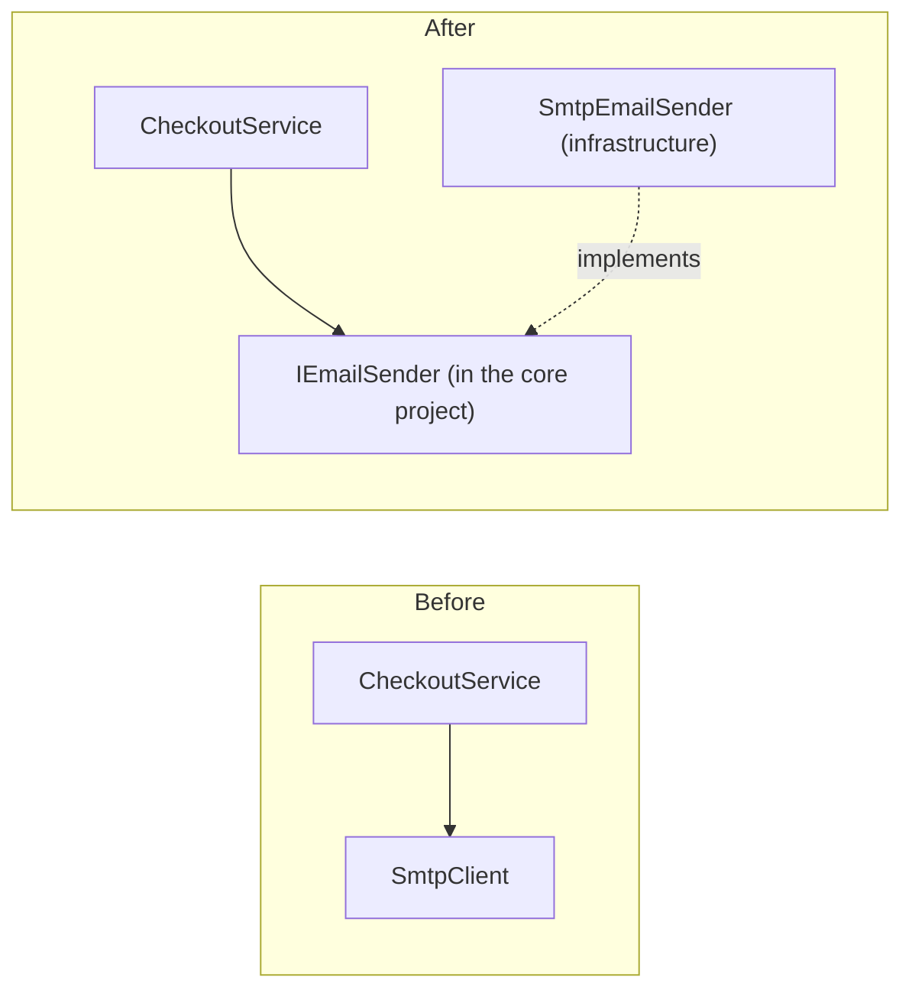

# SOLID: what the five principles mean and when they help or hurt

## TL;DR

SOLID is five object-oriented design principles (Single Responsibility, Open-Closed, Liskov Substitution, Interface Segregation, Dependency Inversion) that share one goal: **manage dependencies so that a change in one place doesn't ripple through the rest of the code**. They help when they're applied where change and test pressure actually exist, mainly at the boundaries between your business logic and I/O. They hurt when applied everywhere up front: you get an interface for every class, layers of indirection, and abstractions built for changes that never come. The usual advice is to write straightforward code first and refactor toward a principle when a real change or test makes the need concrete.

## The problem

A team builds an ASP.NET Core API for an online shop. During code review, "follow SOLID" comes up often, and two developers read it in opposite ways:

1. **Developer A ignores it.** `OrdersController` grows to 900 lines. It calculates prices, applies discounts, calls the payment provider, sends emails with `new SmtpClient()`, and reads `DateTime.UtcNow` directly. Adding a new discount type means editing the same big method that every other change touches. Nobody can unit test the pricing rules without a real SMTP server and payment sandbox, so nobody does.
2. **Developer B applies it everywhere.** Every class gets an interface (`IOrderTotalCalculator`, `IOrderTotalCalculatorFactory`, `IOrderMapper`), each with exactly one implementation. A simple "add a field to the order" change touches eleven files. Reading the code means pressing "Go to implementation" over and over to find the one class that does the work. A generic `IRepository<T>` hides EF Core behind a thinner and less capable API.

Both codebases are hard to change, for opposite reasons. The underlying question is: **what does each SOLID principle actually protect against, and when is that protection worth its cost?**

## Why it happens

### 1. Where SOLID comes from

The five principles were collected by Robert C. Martin from older ideas, and the acronym came later.

| Year | Event |
| --- | --- |
| 1972, 1974 | Parnas proposes splitting modules around design decisions likely to change; Dijkstra names "separation of concerns". Martin later cites both as the roots of SRP [2]. |
| 1987 | Barbara Liskov's OOPSLA keynote "Data Abstraction and Hierarchy" states the substitution idea informally [8]. |
| 1988 | Bertrand Meyer's *Object-Oriented Software Construction* introduces the Open-Closed Principle [7]. |
| 1994 | Liskov and Wing publish "A Behavioral Notion of Subtyping", the formal version of substitutability [9]. |
| Late 1990s | Martin consolidates the coupling and cohesion ideas into the Single Responsibility Principle [2]. |
| 2000 | Martin's paper "Design Principles and Design Patterns" presents OCP, LSP, DIP and ISP as class design principles [1]. SRP is not in it. |
| ~2004 | Michael Feathers emails Martin that, rearranged, the principles spell SOLID [6]. |

Martin's 2000 paper frames all of them as one fight against **software rot**. It names four symptoms: **rigidity** (one change forces a cascade of changes), **fragility** (a change breaks unrelated places), **immobility** (code can't be reused elsewhere) and **viscosity** (the hacky change is easier than the right one). It says every one of them is caused, directly or indirectly, by improper dependencies between modules [1]. That's the key to reading SOLID well: each principle is a tool for **dependency management**, not a goal in itself. Martin has also said plainly that "The SOLID principles are not rules" [5].

### 2. S: Single Responsibility Principle (SRP)

**Statement:** a module should have one, and only one, reason to change [2]. Martin's clarification is that a "reason to change" is a **person or group who requests changes**, such as finance, operations or the DBA team. His restatement starts with "Gather together the things that change for the same reasons." and continues by separating the things that change for different reasons [2]. It is cohesion and coupling under a new name.

**What goes wrong without it:** two unrelated reasons to change share one class, so a change for one breaks the other.

```csharp
public class InvoiceService(AppDbContext db)
{
    public decimal Total(Order o) => /* tax and discount rules: finance asks for changes */ 0m;
    public string RenderHtml(Order o) => /* layout: the design team asks for changes */ "";
    public Task SaveAsync(Invoice i) { db.Add(i); return db.SaveChangesAsync(); } // storage
}
```

A layout tweak for the design team means editing, reviewing and redeploying the class that holds the tax rules, and a merge conflict between the two requests is likely. The fix is to split along the **actors**: `InvoiceCalculator` (finance rules) and `InvoiceRenderer` (layout), with storage left to the endpoint that uses `DbContext`.

**Common misreading:** "SRP means one method per class" or "a class should do one thing". Martin's definition is about *who causes change*, not about size [2]. Splitting a cohesive class into ten one-method classes creates the opposite problem: logic that changes together is now scattered, and every change touches many files (an anti-pattern sometimes called **shotgun surgery**).

**In ASP.NET Core:** the DI docs give a practical smell test. A class with many injected dependencies may have too many responsibilities, and controllers should focus on UI concerns [11].

### 3. O: Open-Closed Principle (OCP)

**Statement:** a module should be open to extension and closed to modification: you change what it does by adding new code, not by editing its existing source [1]. Meyer's original 1988 version achieved this through inheritance: a published class stays unchanged, and subclasses extend it [7]. Martin's version uses abstraction and polymorphism, and he calls plugin architectures its fullest form [1][3].

**What goes wrong without it:** every new variant edits the same method, so each addition risks breaking the existing cases.

```csharp
public decimal ShippingCost(Order o) => o.Carrier switch
{
    "standard" => 5m,
    "express"  => 5m + o.WeightKg * 2m,
    // every new carrier edits this method, and its tests, and redeploys it
    _ => throw new NotSupportedException(o.Carrier)
};
```

**The fix:** an abstraction per variant, and the caller loops over whatever is registered.

```csharp
public interface IShippingRate { string Carrier { get; } decimal For(Order o); }

public sealed class ShippingCalculator(IEnumerable<IShippingRate> rates)
{
    public decimal Cost(Order o) => rates.Single(r => r.Carrier == o.Carrier).For(o);
}
// Adding a carrier = one new class + one AddSingleton<IShippingRate, ...>() line.
```

**The catch:** no design is closed against *every* change. The interface above makes new carriers cheap, but a new *operation* on all carriers (say, "estimated delivery date") now means editing every class, where the `switch` version would have needed one new method. This tradeoff between adding types and adding operations is called the **expression problem**. You have to guess which kind of change is coming, and the cheapest way to guess right is to wait until you've seen it once.

**In ASP.NET Core:** the middleware pipeline is OCP in practice. Each middleware decides whether to pass the request on to the next one, and you add behavior by registering a new component instead of editing existing ones [13]. Registering several implementations of one service and resolving them as `IEnumerable<T>` is supported directly by the container [11].

### 4. L: Liskov Substitution Principle (LSP)

**Statement:** Liskov and Wing's subtype requirement says: "Let φ(x) be a property provable about objects x of type T. Then φ(y) should be true for objects y of type S where S is a subtype of T." [9] In plain words, code written against a base type or interface must keep working, *with the same guarantees*, when it's handed any implementation. Their rules include that a subtype's method may **weaken** the precondition and **strengthen** the postcondition, never the reverse, and that subtypes must preserve the supertype's invariants and history properties [9]. Martin's short version: an overriding method may demand no more from its callers, and promise them no less, than the base method [1]. Martin's 2000 paper traces the contract view to Meyer's **Design by Contract** and uses the Circle/Ellipse example: a `Circle` that inherits from `Ellipse` breaks any caller that expects to set the two foci independently [1].

**What goes wrong without it:** the compiler accepts the substitution, but behavior breaks at run time, often far from the cause.

```csharp
public interface IFileStore
{
    Task SaveAsync(string path, Stream content);
    Task DeleteAsync(string path);
}

public sealed class WriteOnceArchiveStore : IFileStore
{
    public Task SaveAsync(string path, Stream content) => /* ... */ Task.CompletedTask;
    public Task DeleteAsync(string path) => throw new NotSupportedException(); // breaks the contract
}
```

A cleanup job written against `IFileStore` works for months, then crashes the day someone registers the archive store. Callers start adding `if (store is WriteOnceArchiveStore)` checks, which Martin points out are themselves an OCP violation: every new implementation forces a review of those checks [1].

**The fix:** make the contract honest. Either split the interface so the archive store implements only `IFileWriter` (this is ISP, below), or make the capability part of the documented contract. .NET does the second: `Stream.CanSeek` tells callers whether `Seek` and `Position` may throw `NotSupportedException` [14], and `ReadOnlyCollection<T>` throws on `ICollection<T>.Add` [15] while reporting itself as read-only. Both are legal only because the base contract says so up front.

**In ASP.NET Core:** every time you swap a real service for a fake in an integration test, or replace one `IDistributedCache` provider with another, you rely on LSP. A fake that skips validation the real one performs makes tests pass that production would fail.

### 5. I: Interface Segregation Principle (ISP)

**Statement:** several interfaces, each shaped for one kind of client, are better than one general-purpose interface that serves them all [1]. Martin's later wording: keep interfaces small "so that users don't end up depending on things they don't need" [4]. He also warns against the opposite extreme: ISP doesn't mean one interface per caller; group clients by type, and give each type of client its own interface [1].

**What goes wrong without it:** a fat interface couples every client to every method.

```csharp
public interface IUserService   // 14 members; the nightly report job uses one of them
{
    Task<User?> FindAsync(Guid id);
    Task<IReadOnlyList<User>> GetActiveAsync();
    Task ResetPasswordAsync(Guid id);
    Task MergeAccountsAsync(Guid from, Guid to);
    // ...10 more
}
```

The report job's test fake has to implement 14 members, and a signature change to `MergeAccountsAsync` forces a recompile and review of the report job, which never calls it. The fix is a **role interface** for each kind of client, for example `IActiveUserQuery` with just `GetActiveAsync`, implemented by the same class. Martin Fowler calls the fat, mirror-the-class version a **header interface** and recommends pushing toward role interfaces [17].

**In ASP.NET Core:** the options pattern applies the same idea to configuration. Each class depends on a small settings class containing only what it uses, which Microsoft describes as encapsulation and separation of concerns [12]. The three options interfaces (`IOptions<T>`, `IOptionsSnapshot<T>`, `IOptionsMonitor<T>`) are also separate roles: a consumer that never needs reload notifications never sees that API.

### 6. D: Dependency Inversion Principle (DIP)

**Statement:** "Depend upon Abstractions. Do not depend upon concretions." [1] The fuller idea is that **high-level policy** (pricing, ordering rules) shouldn't depend on **low-level details** (SMTP, HTTP clients, the clock). Instead, both depend on an abstraction, and the abstraction belongs to the high-level side. Microsoft's architecture guide describes it the same way: A calls an abstraction that B implements, so at compile time B depends on an interface that A controls [10].

**What goes wrong without it:** business rules are welded to infrastructure.

```csharp
public class CheckoutService
{
    public async Task CompleteAsync(Order o)
    {
        if (DateTime.UtcNow.Hour >= 22) o.ApplyNightSurcharge();  // untestable without waiting for 22:00
        using var smtp = new SmtpClient("mail.example.com");         // needs a real mail server
        await smtp.SendMailAsync("shop@example.com", o.CustomerEmail, "Thanks", "...");
    }
}
```

**The fix:** the core declares what it needs, and infrastructure provides it.



At run time, calls still flow from checkout to SMTP. Only the **compile-time** arrow from the infrastructure class has been reversed [10]. That reversal is the "inversion".

**DIP is not the same as DI.** **Dependency injection** is the mechanism that hands an object its dependencies, usually through the constructor. **DIP** is about which way the source-code dependencies point and who owns the abstraction. ASP.NET Core's built-in container is a DI tool for achieving inversion of control [11]. You can use it with no DIP at all, by injecting concrete classes, and you can follow DIP with no container, by passing dependencies manually. Microsoft notes that DI is made possible by following DIP [10].

**In ASP.NET Core:** constructor injection and the service container [11]; `ILogger<T>` and `IOptions<T>` as framework-owned abstractions; and `TimeProvider`, an abstract class in .NET 8+ for "now", with a `FakeTimeProvider` for tests [16]. Note that `TimeProvider` is an abstract class, not an interface. DIP asks for an abstraction, and Martin's paper accepts either one [1]. The DI docs also list what undermines DIP: the **service locator** pattern (calling `GetService` inside your class), injecting a factory that resolves dependencies at run time, and static access to things like `HttpContext` [11].

### 7. Why over-applying SOLID hurts

Every principle above *adds* something: a class, an interface, a registration, a level of indirection. That cost is paid on every read and every change, whether or not the flexibility is ever used. Fowler calls this the **cost of carry** of a feature built for a presumed future need, and the principle of not building it yet is **YAGNI** ("You Aren't Gonna Need It") [19]. Fowler is careful to add that YAGNI doesn't excuse a messy codebase: refactoring to keep code easy to change is exactly what lets you postpone abstractions safely [19].

Common over-application anti-patterns:

- **An interface for every class.** An interface with a single implementation often adds indirection without real substitutability. Mark Seemann's blog quotes the **Reused Abstractions Principle**: "Having only one implementation of a given interface is a code smell." [18] He also points out that an interface is only a shape; nothing about it guarantees a good abstraction [18].
- **Speculative generality.** Abstract base classes, hooks and parameters added "just in case" that nothing uses. The usual treatment is to delete them: collapse the hierarchy, inline the class [20].
- **"SRP means one method per class."** This misreads SRP as a size rule. The result is cohesive logic smeared across many tiny classes [2].
- **Abstracting a framework that is already an abstraction.** Wrapping EF Core's `DbContext` in a generic `IRepository<T>` with `GetAll`/`Add`/`Remove` usually loses capabilities (projections, `Include`, tracking control) and adds a layer that mirrors the one underneath.
- **The wrong abstraction.** Microsoft's guide warns that "Duplication is always preferable to coupling to the wrong abstraction." [10] A premature OCP extension point bakes in a guess about future change. If the guess is wrong, the abstraction makes the real change harder.

Dan North's well-known critique argues that SOLID's rules should give way to properties you move toward, which he calls CUPID. He singles out SRP for creating artificial seams [21]. You don't have to agree with him to take the point: a principle is a heuristic, and context decides whether it pays.

## Options and solutions

All options assume a typical ASP.NET Core API on .NET 10 with EF Core, a few external services (payments, email), and a team of a few developers that will maintain it for years. The question is **how strictly to apply SOLID**.

### Option 1: Ignore SOLID and write straightforward code

Write endpoints and services that do the work directly: `new` the clients you need, read `DateTime.UtcNow`, put logic where it's first needed. No interfaces unless the framework requires them.

- **Grade:** 4/10. Fast at the start, but the I/O coupling makes tests hard and the code rots exactly as Martin's paper describes.
- **Pros:** Least code and least indirection. Easy to read top to bottom. Ideal for a prototype.
- **Cons:** Business rules can't be tested without real infrastructure. Large classes collect unrelated reasons to change (rigidity, fragility [1]). Retrofitting seams later is harder once logic and I/O are interleaved.
- **Use when:** Throwaway prototypes, spikes, scripts, or tiny services that will be rewritten rather than evolved.

### Option 2: Apply all five principles everywhere, up front

Every class gets an interface, every variation point gets a strategy or factory, every service is split as small as possible, all from the first commit.

- **Grade:** 3/10. Pays the full cost of every abstraction immediately, for flexibility that is mostly never used.
- **Pros:** Everything is mockable. Consistent structure that's easy to explain. Works if you really know which changes are coming, which you rarely do.
- **Cons:** Many single-implementation interfaces [18], speculative generality [20], and high cost of carry [19]. Navigation and onboarding get slower. Wrong guesses about future change get baked into the abstractions [10].
- **Use when:** Almost never in application code. Closer to reasonable for a framework or library whose extension points *are* the product, where unknown third parties need to plug in.

### Option 3: Refactor toward SOLID when real change or test pressure appears

Start simple. Apply a principle only when a concrete signal shows up: a second implementation is needed, a test can't be written without hitting I/O, a class keeps changing for two different reasons, a `switch` is edited for the third time. Then refactor toward the principle that removes that specific pain. The same principles, applied on evidence instead of in advance.

- **Grade:** 9/10. The best fit for typical application code: you pay for each abstraction only once it has proven its worth.
- **Pros:** Abstractions match real variation, because you've seen it. Less code and less indirection than Option 2. Fowler notes refactoring is exactly what makes deferring design safe [19].
- **Cons:** Requires discipline: someone has to notice the signal and do the refactoring rather than add one more `if`. Needs a test suite to refactor safely. The first change of a new kind costs more than if the abstraction had already existed.
- **Use when:** The default for most ASP.NET Core application code: business logic, endpoints, internal services.

### Option 4: Apply DIP and SRP at architectural boundaries only, keep the inside simple

From day one, put an abstraction owned by the core in front of every **I/O boundary**: external HTTP APIs, email, file storage, the clock (`TimeProvider`), message brokers. Keep business logic separate from those adapters (SRP at the layer level, as the Microsoft guide recommends [10]). Inside the core, write plain concrete classes and register them without interfaces.

- **Grade:** 8/10. Cheap, high-value seams exactly where tests and replacements need them, without abstracting everything.
- **Pros:** Business rules are unit-testable from the start. Swapping a provider touches one adapter. Few interfaces, and each one has a clear reason (often a fake for tests, which is a real second implementation).
- **Cons:** You still have to decide what counts as a boundary (is EF Core one?). Doesn't by itself prevent internal classes from growing big; you still need Option 3's habit inside the core.
- **Use when:** Any app that talks to external systems and needs automated tests, which is most of them. Works best combined with Option 3.

### Recommendation

| Option | Grade | Best for |
| --- | --- | --- |
| 3. Refactor toward SOLID under real pressure | 9/10 | Most application code |
| 4. DIP and SRP at I/O boundaries only | 8/10 | The baseline seams in any app with external dependencies and tests |
| 1. Ignore SOLID | 4/10 | Prototypes and throwaway code |
| 2. All five everywhere, up front | 3/10 | Frameworks and libraries with third-party extension points |

Combine **Option 4 as the baseline with Option 3 as the habit**. On day one, put a core-owned abstraction in front of each external system and the clock, and use the options pattern for settings. Everything else starts as plain concrete code. Then let real signals pull in the other principles: split a class when it changes for two different reasons (SRP), add an extension point when the second or third variant actually arrives (OCP), split an interface when a client or a fake is forced to implement members it doesn't use (ISP), and check every new implementation against the contract its callers rely on (LSP).

What it costs: someone must watch for the signals and spend time refactoring, and that needs a test suite you trust. The first change of each new kind will be slower than if the abstraction had been there already. What you give up compared with Option 2 is the uniform "everything is an interface" structure. In return, every abstraction in the codebase exists because something actually needed it.

## What the industry does

- **The framework already does the heavy lifting.** ASP.NET Core ships a DI container with constructor injection, lifetimes and `IEnumerable<T>` resolution [11], a middleware pipeline built for extension [13], the options pattern [12], and abstractions such as `ILogger<T>` and `TimeProvider` [16]. Most apps follow DIP at the edges just by using these well.
- **Layered or "clean" architectures apply DIP at the project level.** Business rules live in a core project with no dependency on infrastructure, and infrastructure implements interfaces the core defines [10].
- **"Rule of three"-style evolution.** Many teams wait for a second or third real variant before extracting an abstraction, following YAGNI [19]. Martin's own *Agile Software Development* describes accepting the first change of a kind and then protecting against further changes of that kind **[unverified]**.
- **Interfaces for fakes at the boundary, concrete classes inside.** Using an interface where a test fake is the second implementation is widely accepted. Interfaces in front of every internal class are increasingly seen as a smell [18].
- **SOLID as vocabulary, not a checklist.** Martin himself presents the principles as heuristics, not rules [5], and critiques like CUPID focus on properties of the resulting code rather than rule compliance [21].

**Anti-patterns:**
- An interface mechanically extracted from every class (header interfaces [17]), each with one implementation [18].
- Abstractions, factories and hooks for variation nobody has asked for (speculative generality [20]).
- Splitting classes by method count instead of by reason to change.
- Implementations that throw `NotSupportedException` for members the contract doesn't allow to fail (LSP violation), and type checks like `if (x is SpecialCase)` to work around them.
- Calling `GetService` inside classes (service locator) or reading `HttpContext` statically instead of injecting dependencies [11].
- Wrapping EF Core in a generic repository that only mirrors `DbSet<T>`.

## Concepts to look up

- **SOLID:** the acronym for SRP, OCP, LSP, ISP and DIP, coined around 2004 from principles Martin collected.
- **Software rot (rigidity, fragility, immobility, viscosity):** Martin's four symptoms of a design degrading through bad dependencies.
- **Coupling and cohesion:** how strongly modules depend on each other, and how strongly a module's parts belong together. SRP is a restatement of both.
- **Separation of concerns:** keeping different kinds of work in different modules; the architectural cousin of SRP.
- **Expression problem:** the tradeoff between making new types easy to add (polymorphism) and making new operations easy to add (a `switch`).
- **Design by Contract:** preconditions, postconditions and invariants as an explicit contract; the basis of LSP's rules.
- **Behavioral subtyping:** Liskov and Wing's formal definition of when a subtype is safely substitutable.
- **Role interface vs header interface:** an interface shaped by one kind of client vs one that mirrors a class's whole public API.
- **Dependency injection (DI) and inversion of control (IoC):** supplying dependencies from outside, usually through a container; a mechanism, distinct from DIP.
- **Service locator:** resolving dependencies from a global container inside a class; hides dependencies and is considered an anti-pattern in ASP.NET Core.
- **Explicit Dependencies Principle:** classes should require their collaborators through their constructor, so their needs are visible.
- **YAGNI and cost of carry:** don't build for presumed needs; unused flexibility still costs effort on every change.
- **Speculative generality:** the code smell of abstractions and hooks that nothing uses.
- **Plugin architecture / ports and adapters:** structures where the core defines interfaces and replaceable adapters implement them; OCP and DIP at system scale.

## Example

The code targets .NET 10 (LTS) with ASP.NET Core minimal APIs. It follows one checkout feature through Options 4 and 3: boundaries abstracted from day one, other principles added only when a real change asks for them.

**Day one: abstractions only at I/O boundaries (Option 4).** The core owns `IPaymentGateway` and `IEmailSender`. The clock comes from `TimeProvider` [16], and settings come through the options pattern [12]. `CheckoutService` itself has no interface, because nothing needs a second implementation of it.

```csharp
// Core project: interfaces owned by the business side (DIP).
public interface IPaymentGateway { Task<PaymentResult> ChargeAsync(Guid orderId, decimal amount, CancellationToken ct); }
public interface IEmailSender    { Task SendAsync(string to, string subject, string body, CancellationToken ct); }

public sealed class CheckoutOptions
{
    public const string Section = "Checkout";
    public int NightSurchargeFromHour { get; init; } = 22;
    public decimal NightSurcharge { get; init; } = 3m;
}

public sealed class CheckoutService(
    IPaymentGateway payments, IEmailSender email, TimeProvider clock, IOptions<CheckoutOptions> options)
{
    private readonly CheckoutOptions _opt = options.Value;

    public async Task<PaymentResult> CompleteAsync(Order order, CancellationToken ct)
    {
        var total = order.Subtotal;
        if (clock.GetUtcNow().Hour >= _opt.NightSurchargeFromHour)  // testable: the clock is injected
            total += _opt.NightSurcharge;

        var result = await payments.ChargeAsync(order.Id, total, ct);
        if (result.Succeeded)
            await email.SendAsync(order.CustomerEmail, "Order confirmed", $"Total: {total:C}", ct);
        return result;
    }
}
```

```csharp
// Program.cs: infrastructure adapters implement the core's interfaces.
builder.Services.Configure<CheckoutOptions>(builder.Configuration.GetSection(CheckoutOptions.Section));
builder.Services.AddSingleton(TimeProvider.System);
builder.Services.AddHttpClient<IPaymentGateway, HttpPaymentGateway>();
builder.Services.AddScoped<IEmailSender, SmtpEmailSender>();
builder.Services.AddScoped<CheckoutService>();   // concrete registration: no single-use interface

app.MapPost("/orders/{id:guid}/checkout", async (Guid id, AppDbContext db, CheckoutService checkout, CancellationToken ct) =>
{
    var order = await db.Orders.FindAsync([id], ct);
    if (order is null) return Results.NotFound();
    var result = await checkout.CompleteAsync(order, ct);
    return result.Succeeded ? Results.NoContent() : Results.Problem(statusCode: 402, detail: result.Reason);
});
```

**The payoff in a test.** The fakes are real second implementations, so these interfaces earned their place.

```csharp
[Fact]
public async Task Adds_night_surcharge_after_configured_hour()
{
    var clock    = new FakeTimeProvider(new DateTimeOffset(2026, 11, 11, 23, 0, 0, TimeSpan.Zero));
    var payments = new RecordingPaymentGateway();          // a hand-written fake implementing IPaymentGateway
    var sut = new CheckoutService(payments, new NullEmailSender(), clock,
                                  Options.Create(new CheckoutOptions()));

    await sut.CompleteAsync(new Order { Subtotal = 100m }, CancellationToken.None);

    Assert.Equal(103m, payments.LastAmount);
}
```

**Months later: the third discount rule arrives (Option 3, OCP).** The first two discounts lived as two `if` statements in `CompleteAsync`, which was fine. When marketing asks for a third and says more are coming, the change is now concrete, so the code is refactored toward an extension point:

```csharp
public interface IDiscountRule { decimal DiscountFor(Order order); }

public sealed class LoyaltyDiscount   : IDiscountRule { public decimal DiscountFor(Order o) => o.IsLoyalCustomer ? o.Subtotal * 0.05m : 0m; }
public sealed class BulkDiscount      : IDiscountRule { public decimal DiscountFor(Order o) => o.ItemCount >= 10 ? 10m : 0m; }
public sealed class FirstOrderDiscount: IDiscountRule { public decimal DiscountFor(Order o) => o.IsFirstOrder ? 5m : 0m; }

// CheckoutService gains one dependency: IEnumerable<IDiscountRule> rules
//   var discount = rules.Sum(r => r.DiscountFor(order));
// Program.cs: one line per rule; the container resolves them all as IEnumerable<IDiscountRule> [11].
builder.Services.AddSingleton<IDiscountRule, LoyaltyDiscount>();
builder.Services.AddSingleton<IDiscountRule, BulkDiscount>();
builder.Services.AddSingleton<IDiscountRule, FirstOrderDiscount>();
```

Each rule obeys the same contract: it returns a non-negative discount and doesn't throw for orders it doesn't apply to. That keeps every implementation substitutable (LSP). The fourth rule will be a new class and one registration line, with no edit to `CheckoutService` (OCP).

## Check your understanding

1. A class has 12 methods, but all of them implement the tax rules that only the finance team asks to change. Does it violate SRP?

   <details><summary>Answer</summary>

   Not by Martin's definition. SRP is about reasons to change, meaning the people or groups who request changes, not about method count [2]. A class whose every part changes for the same reason is cohesive. Splitting it would scatter one concern across many files.

   </details>

2. You register `WriteOnceArchiveStore` as an `IFileStore`, and its `DeleteAsync` throws `NotSupportedException`. Why is this an LSP violation, while `ReadOnlyCollection<T>` throwing on `ICollection<T>.Add` is usually not considered one?

   <details><summary>Answer</summary>

   LSP is about the contract callers can rely on [9]. `IFileStore` promises that `DeleteAsync` deletes, so callers have no reason to expect an exception: the subtype strengthens the precondition. `ICollection<T>` includes read-only collections in its contract (it exposes `IsReadOnly`), so callers are told up front that `Add` may not be supported [15]. The same pattern appears in `Stream.CanSeek` [14]. The fix for `IFileStore` is to make the contract honest: split the interface, or add a capability flag.

   </details>

3. Your project injects every service through ASP.NET Core's container. Does that mean you follow DIP?

   <details><summary>Answer</summary>

   Not necessarily. DI is a mechanism for supplying dependencies [11]. DIP is about the direction of compile-time dependencies and who owns the abstraction [1][10]. If `CheckoutService` receives a concrete `SmtpEmailSender`, or an interface defined in the infrastructure project, the business logic still depends on the detail. DIP holds when the core defines `IEmailSender` and infrastructure implements it.

   </details>

4. Shipping costs are a `switch` on carrier. Your teammate wants to replace it with an `IShippingRate` per carrier "to follow OCP". When is the `switch` the better choice?

   <details><summary>Answer</summary>

   When new carriers are rare and new *operations* over all carriers are more likely. Polymorphism makes adding types cheap and adding operations expensive. A `switch` does the opposite (the expression problem). Without evidence of which change is coming, the simpler `switch` has lower cost of carry [19]. Refactor once a second or third carrier actually arrives.

   </details>

5. Why is a fake in a unit test considered a legitimate reason for an interface, while an interface with one production implementation and no fake often isn't?

   <details><summary>Answer</summary>

   An abstraction is worth its indirection when it has more than one real implementation that callers can substitute [18]. A fake is one: it lets you test business rules without the network or a mail server. An interface with exactly one implementation and no other consumer adds a file and a hop in navigation, but no substitutability. It is speculative generality until a second implementation appears [20].

   </details>

## Sources

1. Robert C. Martin, "Design Principles and Design Patterns", Object Mentor, 2000: § "Symptoms of Rotting Design", § "Principles of Object Oriented Class Design" (OCP, LSP with the Circle/Ellipse dilemma, DIP, ISP). Originally at objectmentor.com; mirror read: https://eli.sdsu.edu/courses/fall19/cs635/Principles_and_Patterns.pdf
2. Robert C. Martin, "The Single Responsibility Principle", The Clean Code Blog, 2014-05-08 (reason to change as people; Parnas and Dijkstra; consolidated in the late 1990s). https://blog.cleancoder.com/uncle-bob/2014/05/08/SingleReponsibilityPrinciple.html
3. Robert C. Martin, "The Open Closed Principle", The Clean Code Blog, 2014-05-12 (Meyer 1988; plugin architectures). https://blog.cleancoder.com/uncle-bob/2014/05/12/TheOpenClosedPrinciple.html
4. Robert C. Martin, "Solid Relevance", The Clean Code Blog, 2020-10-18 (short restatements of all five). https://blog.cleancoder.com/uncle-bob/2020/10/18/Solid-Relevance.html
5. Robert C. Martin, "Getting a SOLID start", Uncle Bob Consulting, 2009-02-12. https://sites.google.com/site/unclebobconsultingllc/getting-a-solid-start
6. InfoQ, "Uncle Bob Martin on Clean Software, Craftsperson, Origins of SOLID, DDD, & Software Ethics" (podcast with Wesley Reisz), 2018-08-24: Martin's account of Michael Feathers naming SOLID around 2004. https://www.infoq.com/podcasts/uncle-bob-solid-ddd
7. Bertrand Meyer, *Object-Oriented Software Construction*, 1st edition, Prentice Hall, 1988: the definition of open and closed modules (p. 23, as cited in secondary sources) and the inheritance-based mechanism. Cite-only; not read directly.
8. Barbara Liskov, "Data Abstraction and Hierarchy", keynote, OOPSLA '87 Addendum to the Proceedings, 1987; reprinted in ACM SIGPLAN Notices 23(5), May 1988. https://doi.org/10.1145/62139.62141
9. Barbara H. Liskov and Jeannette M. Wing, "A Behavioral Notion of Subtyping", ACM Transactions on Programming Languages and Systems 16(6), November 1994, pp. 1811-1841: the Subtype Requirement, invariants and history properties, and the definition of the subtype relation (methods rule with pre- and post-condition rules, constraint rule). https://www.cs.columbia.edu/~wing/publications/LiskovWing94.pdf
10. Microsoft, "Architectural principles", *Architect Modern Web Applications with ASP.NET Core and Azure*: § "Separation of concerns", § "Dependency inversion", § "Explicit dependencies", § "Single responsibility", § "Don't repeat yourself (DRY)". https://learn.microsoft.com/en-us/dotnet/architecture/modern-web-apps-azure/architectural-principles
11. Microsoft, "Dependency injection in ASP.NET Core", ASP.NET Core 10 docs: overview, service registration (multiple implementations and `IEnumerable<T>`), § "Design services for dependency injection", § "Recommendations" (service locator, static `HttpContext`). https://learn.microsoft.com/en-us/aspnet/core/fundamentals/dependency-injection
12. Microsoft, "Options pattern in ASP.NET Core", ASP.NET Core 10 docs (encapsulation and separation of concerns). https://learn.microsoft.com/en-us/aspnet/core/fundamentals/configuration/options
13. Microsoft, "ASP.NET Core middleware", ASP.NET Core 10 docs (pipeline, `Use`/`Run`/`Map`, short-circuiting, order). https://learn.microsoft.com/en-us/aspnet/core/fundamentals/middleware/
14. Microsoft, "Stream.CanSeek Property", .NET API reference, § Remarks. https://learn.microsoft.com/en-us/dotnet/api/system.io.stream.canseek
15. Microsoft, "ReadOnlyCollection<T>.ICollection<T>.Add(T) Method", .NET API reference. https://learn.microsoft.com/en-us/dotnet/api/system.collections.objectmodel.readonlycollection-1.system-collections-generic-icollection-t--add
16. Microsoft, "TimeProvider Class", .NET API reference (abstract class; `FakeTimeProvider` for tests). https://learn.microsoft.com/en-us/dotnet/api/system.timeprovider
17. Martin Fowler, "RoleInterface", martinfowler.com bliki, 2006-12-22. https://martinfowler.com/bliki/RoleInterface.html
18. Mark Seemann, "Interfaces are not abstractions", ploeh blog, 2010-12-02 (blog; community practice). https://blog.ploeh.dk/2010/12/02/Interfacesarenotabstractions/
19. Martin Fowler, "Yagni", martinfowler.com bliki (cost of build, delay, carry and repair; refactoring as an enabling practice). https://martinfowler.com/bliki/Yagni.html
20. Refactoring.Guru, "Speculative Generality" (community reference site). https://refactoring.guru/smells/speculative-generality. The smell is usually traced to Martin Fowler, *Refactoring*, 2nd edition, Addison-Wesley, 2018, chapter 3 "Bad Smells in Code" **[unverified]**.
21. Dan North, "CUPID: for joyful coding", dannorth.net (blog; community critique), 2022-02-10. https://dannorth.net/blog/cupid-for-joyful-coding/

**Unverified claims:**
- The exact page and chapter of Meyer's 1988 OCP definition (p. 23 comes from secondary sources, not from the book itself).
- That Martin's *Agile Software Development: Principles, Patterns, and Practices* describes accepting the first change of a kind before abstracting against it.
- That "Speculative Generality" appears as a named smell in chapter 3 of Fowler's *Refactoring*.

## Related

- [Error handling that depends on message text instead of error codes](../../architecture/error-handling-by-message-text.md): another coupling problem; replacing a hidden dependency on wording with a stable, named contract follows the same idea as depending on abstractions.
- [Keeping a project's decisions and conventions findable by AI assistants and new developers](../documenting-project-decisions-for-ai-and-new-developers.md): where to record which principles a project follows, and why, so they are applied consistently.
