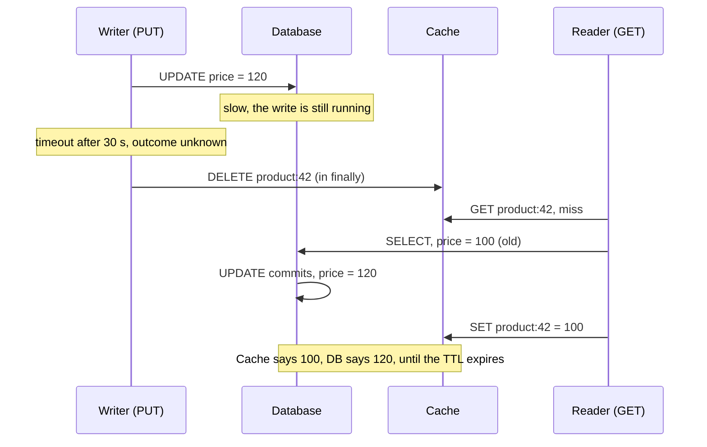

# Stale cache reads while a DB write's outcome is unknown

## TL;DR

When the app writes to the database and the call is still in flight, or times out, the app can't know whether the write was applied. The cache may still hold the old value, and a concurrent reader can even put the old value back after you invalidate. A read that overlaps a write and sees the old value is normal. The real bugs are staleness that **outlives** the write, or that never ends. The usual defense has three parts:
- Delete the cache entry on every outcome, including success, failure and timeout.
- Make writes safe to retry.
- Use TTLs to bound how long a stale value can survive.

When even that isn't enough, drive invalidation from the database's own change log.

## The problem

An ASP.NET Core API serves products. Reads use the **cache-aside** pattern: look in the cache, and on a miss, load from the database and store the result in the cache. Writes update the database, then delete the cache entry.

A request to change a product's price runs `UPDATE`, and the database is slow. The request times out after 30 seconds. The developer now has three questions:

1. **During those 30 seconds**, other requests read the product. They get the old price from the cache. Is that wrong?
2. **After the timeout**, did the update happen or not? The database might have committed it, rolled it back, or still be working on it.
3. **What does the cache hold now?** The typical code is `await SaveChangesAsync(); await cache.RemoveAsync(key);`. When `SaveChangesAsync` throws, the delete never runs. If the update did commit, the database has the new price while the cache serves the old one until its entry expires, and nothing reports an error.

The symptom users see: "I changed the price, the save showed an error, but some users see the new price and others see the old one." Or the reverse: the save "failed", yet the new price appears minutes later.

## Why it happens

There are four separate mechanisms here. They mix together in practice, so it helps to pull them apart.

### 1. Overlapping reads seeing the old value is normal

While a write is in flight, it hasn't taken effect yet from the reader's point of view. Even in a **linearizable** system, the strongest single-object consistency model, a read that overlaps a write may return either the old or the new value [3]. So question 1 is not a bug. The guarantee you can reasonably want is about what happens **after** the write is acknowledged.

### 2. A timeout means "unknown", not "failed"

When a network request gets no reply, the caller can't distinguish between three cases [1]:
- the request was lost;
- the server processed it and the reply was lost;
- the request is still queued or running.

The request can even be delivered and applied **after** the caller gave up waiting [1]. The same is true of a database commit. If the connection drops during `COMMIT`, the client can't know whether the transaction committed [5][10]. Retrying blindly can apply the action twice [2][10].

### 3. Two systems, two writes: the dual-write problem

The database and the cache are two separate systems, and the code writes to each of them. DDIA names this pattern **dual writes**, and gives "write the database, then invalidate the cache" as an example [4]. Dual writes fail in two ways [4]:

- **Partial failure.** One write succeeds and the other doesn't. That's the "exception skipped `RemoveAsync`" bug above. Making both succeed or both fail is the **atomic commit** problem, which is expensive to solve.
- **Races.** Concurrent writers can reach the two systems in different orders, and the systems end up permanently disagreeing without any error.

### 4. Cache-aside has a race even when everything succeeds

Microsoft's cache-aside guidance says to update the database first and then invalidate the cache. It also says this order still doesn't guarantee consistency [7]. One interleaving shows why:

| Time | Reader (GET) | Writer (PUT) | DB | Cache |
| --- | --- | --- | --- | --- |
| t1 | cache miss | | 100 | (empty) |
| t2 | `SELECT` → 100 | | 100 | (empty) |
| t3 | | `UPDATE` → 120, commit | 120 | (empty) |
| t4 | | delete cache key | 120 | (empty) |
| t5 | `SET key = 100` | | 120 | **100 (stale)** |

The reader loaded the old row before the write and stored it after the invalidation. Facebook calls this a **stale set** [11]. It lasts until the TTL expires or the next write invalidates the key.

### How a timeout makes it worse

Combine mechanisms 2 and 4. You delete the cache entry right after the timeout, but the commit lands **later**. A reader in between loads the old row and caches it:



No ordering of "write, then delete" inside the request fixes this. The request doesn't know when, or whether, the commit will happen. Only something that observes the **actual commit** can invalidate at the right moment, which is Option 3 below.

### Other sources of stale reads

A timeout isn't the only way to get stale data:
- **HybridCache local caches.** HybridCache puts an in-memory layer in front of a distributed cache such as Redis [9]. Removing a key clears the current server's in-memory (L1) copy and the distributed (L2) copy, but **not** the L1 copies on other servers [8]. Those copies live until their local expiration.
- **Read replicas.** If you read from database replicas, replication lag adds its own staleness [6].

## Options and solutions

### Option 1: Always delete the cache entry, and keep TTLs short

Put the cache delete in a `finally` block, so it runs on success, failure and timeout. Deleting is **idempotent**, so an extra delete only costs one cache miss. Facebook chose delete-on-write over update-on-write for this reason [11]. Give every entry a TTL, so any stale value that slips through dies within a known time.

- **Grade:** 9/10. The default: almost free, and it fixes the most common bug, but it only bounds staleness instead of preventing it.
- **Pros:** Two lines of code. It fixes the most common real bug (an exception skipping invalidation). Your staleness has a known upper bound, the TTL.
- **Cons:** It doesn't close the race in mechanism 4 or the late-commit case. It only bounds them. If the cache itself is down when you delete, you're back to relying on the TTL.
- **Use when:** Always. This is the baseline for any cache-aside code.

### Option 2: Make writes safe to retry (idempotency)

This answers "did it commit?" for the database side. You either retry safely, or check before retrying:

- **Naturally idempotent writes.** "Set price to 120" can run twice with the same result; "add 1 to stock" can't. Prefer set-style updates where you can.
- **Idempotency keys.** The client generates a unique request ID, the server stores it under a unique constraint, and a retry with the same ID becomes a no-op or returns the original result [5][14][15]. EF Core's docs suggest client-generated GUID keys for exactly this reason: a retried insert then fails on the duplicate key instead of creating a second row [10].
- **Verify before retrying.** EF Core's `ExecuteInTransactionAsync` takes a `verifySucceeded` callback, and the docs also describe a tracking-row approach [10].

- **Grade:** 8/10. Essential whenever writes can be retried, but on its own it does nothing for the cache.
- **Pros:** It fixes the "did my write happen?" question at its root, and makes automatic retries safe. EF Core's `EnableRetryOnFailure` retries a failed commit as if it rolled back, which can duplicate rows when it actually committed [10].
- **Cons:** It doesn't touch the cache at all, so you still need Option 1. Idempotency keys need storage and a cleanup policy.
- **Use when:** Any write that can be retried by your code, a library such as EF Core's execution strategy, or a user pressing "Save" again. That covers almost every write.

### Option 3: Invalidate from the database's change log (transactional outbox or CDC)

Stop asking the request to invalidate the cache. Instead, invalidate when the database **actually commits**, in the order it committed:

- **Transactional outbox.** In the same transaction as the update, insert an "invalidate product:42" row into an `outbox` table. A background worker reads the outbox and deletes the cache keys [4][12]. The invalidation exists if and only if the data change committed.
- **Change data capture (CDC).** A tool such as Debezium reads the database's transaction log and emits a change event per row [13]. A consumer deletes the matching cache keys. Facebook does this at scale: daemons read committed SQL and broadcast deletes [11].

- **Grade:** 7/10. The only option that follows the real commit, but it costs infrastructure and is still asynchronous.
- **Pros:** It closes the late-commit case, because invalidation follows the real commit, whenever it happens. It also removes the partial-failure half of the dual-write problem, since the database decides the order of changes [4].
- **Cons:** It needs more infrastructure: a worker, and for CDC, Kafka Connect or similar. It's still **asynchronous**, so readers can see stale data for a short lag [4]. Delivery is at least once [12][13], so consumers must be idempotent. Cache deletes already are.
- **Use when:** Staleness after a write is costly (prices, permissions, stock), several services cache the same data, or you already run an outbox for events.

### Option 4: Prevent stale sets with leases or versions

Facebook's **leases** give a reader a token on a cache miss. A delete for that key invalidates the token, so the reader's later "set the old value" is rejected [11]. This closes the race in mechanism 4. Because a token is handed out at most once every 10 seconds per key, leases also damp **thundering herds**: in Facebook's measurements, peak DB load for a hot key dropped from 17K to 1.3K requests per second [11].

- **Grade:** 4/10. It solves the exact race, but you'd have to build it yourself on Redis or HybridCache.
- **Pros:** It targets the exact race that TTLs only bound.
- **Cons:** Redis and HybridCache don't provide this out of the box. You'd build it yourself, for example with versioned values and a compare-and-set script **[unverified]**: no primary source for a specific Redis implementation was checked. It's real complexity.
- **Use when:** High read traffic on keys that are written often, and stale sets are actually observed.

### Option 5: Read your own writes, or skip the cache

For the user who made the change, read from the database (not the cache) for a short window after their write. DDIA describes this for replicas as **reading your own writes** [6]. For data that must always be fresh, don't cache it, or use a very short TTL.

- **Grade:** 6/10. Great for the editor's own view, but narrow: other users still see the cache.
- **Pros:** The person most likely to notice ("I just changed it!") always sees the truth. It's simple to reason about.
- **Cons:** It doesn't help other users. It adds DB load and needs per-user tracking of their last write.
- **Use when:** Admin screens, settings pages, and anything where the editor immediately views the result.

### Recommendation

| Option | Grade | Best for |
| --- | --- | --- |
| 1. Always delete + short TTLs | 9/10 | Every cache-aside setup, as the baseline |
| 2. Idempotent writes | 8/10 | Any write that can be retried |
| 3. Outbox or CDC invalidation | 7/10 | Data where staleness is costly, or several services cache it |
| 5. Read your own writes / skip cache | 6/10 | Edit screens where the editor checks the result |
| 4. Leases or versions | 4/10 | Hot keys where stale sets are actually observed |

The options combine rather than compete. In a typical ASP.NET Core app, start with **Option 1 + Option 2**:
- invalidate in `finally`;
- set TTLs that match how stale each kind of data may be;
- use set-style or idempotency-keyed writes so retries are safe.

This fixes the common bugs with little code. What you give up: a stale value can still survive for up to one TTL after a racing read or a late commit. When that bound is too loose, add **Option 3** (outbox first, if you don't already run Kafka). Use **Option 5** for screens where the editor checks their own change.

## What the industry does

- **Delete, don't update.** Writers invalidate the key instead of writing the new value into the cache. Deletes are idempotent and can't put values in the wrong order [11].
- **Update the database first, then invalidate.** Invalidating first lets a reader reload the old value before the write lands [7].
- **TTLs as a safety net**, even when invalidation exists. Facebook describes its system as "best-effort eventual consistency" [11], so even very large systems accept bounded staleness.
- **Invalidation from the commit log** at scale. Facebook broadcasts deletes from committed SQL [11], and Debezium lists cache invalidation as a use case [13].
- **Idempotency keys** on write APIs: Stripe's `Idempotency-Key` header [14] and AWS's client request tokens [15]. Retries use exponential backoff with jitter [14][16].
- **Delayed double delete** (delete, write, wait briefly, delete again) is a common community technique to shrink the stale-set window. It's a mitigation, not a guarantee **[unverified]**: only blog posts describe it, no primary source.

**Anti-patterns:**
- Setting the cache to the new value on write.
- Invalidating the cache before the database write.
- An invalidation that an exception can skip.
- Cache entries with no TTL.
- Treating a timeout as "the write failed".
- Turning on automatic DB retries for writes that aren't idempotent [10].

## Concepts to look up

- **Cache-aside (lazy loading):** the app reads through the cache and fills it on a miss; the app, not the cache, talks to the database.
- **Write-through cache:** writes go to the cache and the store together, so the cache is updated on every write.
- **Cache invalidation:** removing or marking cached data stale when the source changes.
- **TTL (time to live):** how long an entry may live before it expires.
- **Dual writes:** application code writing the same change to two systems, with no atomicity between them.
- **Atomic commit / two-phase commit (2PC):** making several systems all commit or all abort.
- **Transactional outbox:** recording a message in the same DB transaction as the data change, then publishing it from the table.
- **Change data capture (CDC):** turning a database's transaction log into a stream of change events.
- **Idempotency / idempotency key:** an operation that has the same effect when applied more than once, made idempotent with a client-supplied unique ID.
- **At-least-once delivery:** a message may arrive more than once, so consumers must tolerate duplicates.
- **Linearizability:** the system behaves as if there were a single copy of the data, and every operation takes effect at one instant.
- **Read-your-writes consistency:** a user always sees their own updates.
- **Stale set and leases:** a reader writing an outdated value into the cache, and Facebook's token mechanism that prevents it.
- **Thundering herd / cache stampede:** many requests missing the same key at once and all hitting the database.
- **Eventual consistency:** replicas or derived copies converge if writes stop, with no bound on when.

## Example

The code targets .NET 10 (LTS), ASP.NET Core minimal APIs, EF Core 10, and `HybridCache` from the `Microsoft.Extensions.Caching.Hybrid` package.

**Read path: cache-aside with explicit TTLs.**

```csharp
app.MapGet("/products/{id:int}", async (int id, HybridCache cache, AppDbContext db, CancellationToken ct) =>
{
    var product = await cache.GetOrCreateAsync(
        $"product:{id}",
        async token => await db.Products.AsNoTracking()
            .FirstOrDefaultAsync(p => p.Id == id, token),
        new HybridCacheEntryOptions
        {
            Expiration = TimeSpan.FromMinutes(5),            // L2 (e.g. Redis): upper bound on staleness
            LocalCacheExpiration = TimeSpan.FromSeconds(30)  // L1: other servers' copies aren't invalidated [8]
        },
        cancellationToken: ct);

    return product is null ? Results.NotFound() : Results.Ok(product);
});
```

**Write path, buggy version.** A timeout skips invalidation.

```csharp
app.MapPut("/products/{id:int}/price", async (int id, decimal price, HybridCache cache, AppDbContext db, CancellationToken ct) =>
{
    var product = await db.Products.FindAsync([id], ct);
    product!.Price = price;
    await db.SaveChangesAsync(ct);             // times out -> throws, but may still commit later
    await cache.RemoveAsync($"product:{id}");  // never runs when the line above throws
    return Results.NoContent();
});
```

**Write path, fixed version.** It uses an idempotent set and always invalidates (Options 1 + 2).

```csharp
app.MapPut("/products/{id:int}/price", async (int id, decimal price, HybridCache cache, AppDbContext db, CancellationToken ct) =>
{
    try
    {
        // "Set price to X" is naturally idempotent: a retry after a timeout can't double-apply it.
        await db.Products
            .Where(p => p.Id == id)
            .ExecuteUpdateAsync(s => s.SetProperty(p => p.Price, price), ct);
    }
    finally
    {
        // Runs on success, failure and timeout. Deleting is idempotent, so a needless delete costs one cache miss.
        // CancellationToken.None: invalidate even if the client disconnected.
        await cache.RemoveAsync($"product:{id}", CancellationToken.None);
    }
    return Results.NoContent();
});
```

**A non-idempotent write made safe to retry with an idempotency key** [10][14].

```csharp
app.MapPost("/orders", async ([FromHeader(Name = "Idempotency-Key")] Guid requestId, CreateOrder request, AppDbContext db, CancellationToken ct) =>
{
    // The client-generated key becomes the primary key, so a retried insert can't create a second order.
    db.Orders.Add(new Order { Id = requestId, ProductId = request.ProductId, Quantity = request.Quantity });
    try
    {
        await db.SaveChangesAsync(ct);
    }
    catch (DbUpdateException ex) when (IsUniqueKeyViolation(ex)) // provider-specific check, e.g. SQL Server error 2627
    {
        // An earlier attempt already committed. Treat it as success and return the existing order.
    }
    return Results.Created($"/orders/{requestId}", null);
});
```

Option 3 in this setup means adding an `OutboxMessages` table. You insert "invalidate `product:{id}`" in the same `SaveChangesAsync` as the change, and a `BackgroundService` reads that table and calls `RemoveAsync`.

## Check your understanding

1. A `GET` arrives while a `PUT` for the same product is still in flight, and returns the old price. Is that a bug?

   <details><summary>Answer</summary>

   No. Until the write completes, it hasn't happened from the reader's point of view. Even a linearizable system may return either value to a read that overlaps a write [3]. Worry about staleness **after** the write completes.

   </details>

2. Why do most systems delete the cache key on write instead of setting it to the new value?

   <details><summary>Answer</summary>

   Deletes are idempotent and carry no value that can arrive in the wrong order. With set-on-write, two concurrent writers can reach the database and the cache in different orders, and the cache keeps the losing value permanently. That's the dual-write race [4]. A delete just forces the next reader to load the current value from the database.

   </details>

3. A write times out. Your `finally` deletes the cache key immediately, and the commit lands two seconds later. How can the cache still end up stale, and what limits how long?

   <details><summary>Answer</summary>

   A reader that misses the cache between your delete and the commit loads the **old** row and caches it. The TTL limits how long that value survives. CDC or an outbox fixes it properly, because invalidation then follows the real commit.

   </details>

4. Why is retrying `PUT /products/42/price` (set price to 120) after a timeout safe, while retrying `POST /orders` isn't, without extra work?

   <details><summary>Answer</summary>

   Setting a value twice gives the same result, so the operation is idempotent. Inserting an order twice creates two orders. The POST needs an idempotency key, such as a client-generated ID enforced by a unique constraint, so the retry becomes a no-op [10][14].

   </details>

5. Your API runs on three servers with HybridCache over Redis. Server A updates a product and calls `RemoveAsync`. What do servers B and C return, and for how long?

   <details><summary>Answer</summary>

   They can return the old value from their own in-memory (L1) copy until that copy expires. `RemoveAsync` clears server A's L1 and the shared L2, but not other servers' L1 [8]. Keep `LocalCacheExpiration` short for data that changes.

   </details>

## Sources

DDIA = Martin Kleppmann and Chris Riccomini, *Designing Data-Intensive Applications*, 2nd edition (2026). Page numbers are printed page numbers.

1. DDIA, Ch. 9 "The Trouble with Distributed Systems", § "Unreliable Networks", pp. 347–348; § "Timeouts and Unbounded Delays", p. 352.
2. DDIA, Ch. 5 "Encoding and Evolution", § "The problems with remote procedure calls", p. 183.
3. DDIA, Ch. 10 "Consistency and Consensus", § "Linearizability", p. 402; § "What Makes a System Linearizable?", p. 404.
4. DDIA, Ch. 12 "Stream Processing", § "Keeping Systems in Sync", pp. 501–502; § "Change Data Capture", pp. 503–507; sidebar "Change Data Capture and Database Schemas" (outbox), pp. 507–508.
5. DDIA, Ch. 13 "A Philosophy of Streaming Systems", § "The End-to-End Argument for Databases", pp. 562–566.
6. DDIA, Ch. 6 "Replication", § "Reading your own writes", pp. 210–211.
7. Microsoft, "Cache-Aside pattern", Azure Architecture Center. https://learn.microsoft.com/en-us/azure/architecture/patterns/cache-aside
8. Microsoft, "HybridCache library in ASP.NET Core". https://learn.microsoft.com/en-us/aspnet/core/performance/caching/hybrid
9. Microsoft, "Distributed caching in ASP.NET Core". https://learn.microsoft.com/en-us/aspnet/core/performance/caching/distributed
10. Microsoft, "Connection Resiliency", EF Core docs, § "Transaction commit failure and the idempotency issue". https://learn.microsoft.com/en-us/ef/core/miscellaneous/connection-resiliency
11. R. Nishtala et al., "Scaling Memcache at Facebook", NSDI 2013: §2 (delete on write), §3.2.1 (leases), §4.1 (invalidation from committed SQL), §5 (consistency). https://www.usenix.org/system/files/conference/nsdi13/nsdi13-final170_update.pdf
12. Chris Richardson, "Pattern: Transactional outbox", microservices.io. https://microservices.io/patterns/data/transactional-outbox.html
13. Debezium documentation. https://debezium.io/documentation/
14. Brandur Leach, "Designing robust and predictable APIs with idempotency", Stripe blog, 2017. https://stripe.com/blog/idempotency
15. Malcolm Featonby, "Making retries safe with idempotent APIs", Amazon Builders' Library. https://aws.amazon.com/builders-library/making-retries-safe-with-idempotent-APIs/
16. Marc Brooker, "Timeouts, retries, and backoff with jitter", Amazon Builders' Library. https://aws.amazon.com/builders-library/timeouts-retries-and-backoff-with-jitter/

**Unverified claims in this entry:**
- The Redis implementation of leases with versioned values and compare-and-set. No primary source was checked.
- Delayed double delete. Only community blog posts describe it.

## Related

- [Passing IDs between services](../distributed-systems/passing-ids-between-services.md): message IDs for deduplicating at-least-once deliveries, an application of the idempotency ideas here.
- [ACID: what a database transaction actually guarantees](../best-practices/principles/acid-transactions.md): what a single database transaction does and doesn't promise, including isolation levels and lost updates, and why its guarantees stop at the database boundary, which is where this entry's problem starts.
