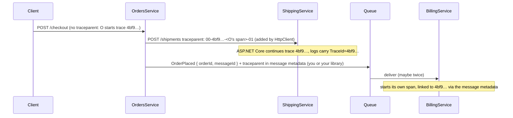

# Passing IDs between services

## TL;DR

Two very different kinds of ID travel between services, and they need opposite treatment:
- **Entity IDs** (order 42, customer 7) are **business data**. They belong in the request or message body, are owned and generated by one service, and are part of the API contract. Other services store them but treat them as opaque: they never parse them or assume a format.
- **Correlation (trace) IDs** identify **one operation's journey** across services, so you can join their logs and traces. They are infrastructure metadata. They belong in headers, use the W3C `traceparent` standard, and should never drive business logic. In .NET, ASP.NET Core and `HttpClient` propagate them automatically over HTTP; across a message queue you carry them in the message's metadata.

A third ID, the **message ID**, identifies one event so a consumer can detect duplicates. Don't confuse it with either of the others.

## The problem

An ASP.NET Core `OrdersService` handles checkout. It calls `ShippingService` over HTTP to book a delivery, and publishes an `OrderPlaced` message to a queue that `BillingService` consumes. The developer has questions about IDs:

1. **What should the order ID look like when Orders sends it to Shipping?** The database uses `int` keys. Shipping stores it in an `int` column. Months later, Orders moves to GUID keys and Shipping breaks.
2. **How do I find everything that happened during one checkout?** A customer reports a failed checkout. Each service has its own logs, and nothing ties a line in Orders to the matching lines in Shipping and Billing.
3. **So should I add a `correlationId` to every DTO and every method?** One developer starts doing this. Half the methods forget to pass it on, and it never reaches the queue consumer.
4. **Why did a shipment get booked for the wrong order?** A method takes `(Guid customerId, Guid orderId)`, and a caller passed them in the wrong order. Both are `Guid`, so it compiled.
5. **Billing charged twice.** The queue delivered `OrderPlaced` twice. How is Billing supposed to know the second one is a duplicate?

## Why it happens

### 1. "An ID" is really three different things

| | Entity ID | Correlation / trace ID | Message ID |
| --- | --- | --- | --- |
| Identifies | A business object (an order) | One operation across services (this checkout) | One message or event |
| Created by | The service that owns the entity | Whoever starts the operation (or the first service) | The producer of the message |
| Lifetime | As long as the entity exists, often years | One request or workflow | Until duplicates can no longer arrive |
| Travels in | Request or message **body** | **Headers** / message metadata | Message envelope |
| Used for | Business logic, storage, lookups | Joining logs and traces | Deduplication |

Most of the trouble in the scenario comes from mixing these up: treating a correlation ID as business data (question 3), or an entity ID as something whose format you can rely on (question 1).

### 2. Entity IDs: one owner, everyone else treats them as opaque

In a microservice design, each service owns its data, and others reach it only through the owner's API or messages [1]. Services therefore can't join across databases; they **refer to each other's entities by ID**. Microsoft's .NET microservices guidance recommends that one aggregate hold only the foreign-key ID of another, not a navigable object reference, and notes that an entity's identity can cross service boundaries [2].

That makes the ID part of the **contract** between the services. The owner decides its format. If consumers bake in assumptions ("it's an `int`", "it increases over time", "the first 8 characters are a date"), they are coupled to the owner's storage choice, and the owner can't change it without breaking them. That's what broke Shipping in question 1. RFC 9562 gives the same advice for UUIDs: treat them "as opaquely as possible" [3]. A consumer should store the ID and send it back, nothing else.

Inside one codebase, a second problem appears: when every ID is a `Guid` or `int`, the compiler can't tell an `OrderId` from a `CustomerId`. That's **primitive obsession**, and swapped arguments (question 4) are its classic bug [4].

### 3. Correlation IDs: one operation, many processes

One checkout becomes many units of work in several processes. Each process writes its own logs, so you need one ID that all of them record. The industry standard is **W3C Trace Context**. Its `traceparent` header carries four fields [6]:

```text
traceparent: 00-4bf92f3577b34da6a3ce929d0e0e4736-00f067aa0ba902b7-01
             │  │                                │                └ trace-flags (e.g. sampled)
             │  │                                └ parent-id: the calling span (8 bytes)
             │  └ trace-id: the whole operation (16 bytes), the same in every service
             └ version
```

The **trace-id** is the correlation ID: every service involved in the checkout records the same one. The spec says trace-ids should be globally unique and preferably random [6], and that these fields exist only to enable trace correlation and must not carry personal data [6].

.NET implements this with `System.Diagnostics.Activity`, which is what other tools call a **span**. W3C is the default ID format since .NET 5 [7]. ASP.NET Core reads the incoming `traceparent` and starts an `Activity` for the request; `HttpClient` writes the header on outgoing calls. Microsoft's docs say apps get trace IDs flowing "with no special coding" [7][15]. The logging system then adds `TraceId` and `SpanId` to every log entry's scope by default [8]. So the correlation ID you wanted in question 2 already exists. You just need to log it (with scopes enabled) and search for it.

Here is the checkout as one trace:



### 4. Queues don't propagate anything for you

HTTP has headers, and .NET fills them in. A message on a queue is different: the context only travels if the producer puts it in the message. OpenTelemetry's messaging conventions say a producer should attach the creation context to each message, but they don't specify the mechanism [10]. In practice it goes in the message's headers or properties, next to the body rather than inside it **[unverified]**. The conventions also recommend that the consumer **link** its span to the producer's context rather than making it a child, because one message can be processed much later, or in a batch with others [10].

That's why the hand-rolled `correlationId` in question 3 never reached Billing: nothing put it into the message.

### 5. Baggage is not a place for business IDs

Trace context has a companion, **baggage**: arbitrary key-value pairs that ride along with the trace [11][12]. It's tempting to put `userId` or `tenantId` there so every service "just has it". But baggage is propagated to every downstream call, can leave your network, and can reach third-party APIs [11][12]. And logic that depends on baggage depends on a side channel that isn't in any contract. Put IDs your code needs in the request itself.

### 6. Duplicate messages need their own ID

Queues usually deliver **at least once**, so a consumer can get the same message twice (question 5). The order ID can't tell "the same event again" from "a second, legitimate event about the same order". That needs an ID for the **message**. The CloudEvents spec defines exactly this: producers must make `source` + `id` unique per event, and consumers may treat two events with the same pair as duplicates [13].

## Options and solutions

There are two decisions here: how to pass entity IDs, and how to pass correlation IDs. Each has its own options.

### Entity IDs

#### Option 1: Share the owner's raw database key and let consumers assume its type

Orders sends `"orderId": 42`; Shipping stores it in an `int` column.

- **Grade:** 4/10. Works until the owner changes its storage, and then every consumer breaks.
- **Pros:** Simplest. Small and readable.
- **Cons:** Couples consumers to the owner's database. Sequential keys leak volume and invite enumeration if they ever reach clients (see the related entry). Nothing stops IDs from different entities being mixed up.
- **Use when:** Two services owned by the same team, where you accept that a key change means changing both.

#### Option 2: Owner-generated, globally unique IDs that consumers treat as opaque

The owning service generates a UUID (or a separate public ID) when it creates the entity. The contract documents the field as a string identifier and promises nothing about its format. Consumers store it as received (a string column, or a `Guid` if the contract guarantees a UUID) and never parse, sort or compute with it. Use `Guid.CreateVersion7()` (.NET 9+) for time-ordered UUIDs if the owner's database benefits from ordered inserts [3][14]. An optional type prefix such as `ord_…` makes IDs self-describing in logs and catches wrong-type IDs at a glance; Stripe uses this convention [5].

- **Grade:** 9/10. The default: the ID is unique everywhere, can be created before the insert, and doesn't tie consumers to storage.
- **Pros:** The owner can change storage without breaking consumers. IDs are unique across services, so they never collide in logs or shared stores. The ID can be generated before the database insert, which helps with idempotent creation.
- **Cons:** Longer IDs, bigger indexes than `int`. Consumers lose "free" properties like ordering, and must get them from real fields (`createdAt`) instead.
- **Use when:** Almost always, for entities referenced by other services.

#### Option 3: Strongly typed IDs inside each service

Wrap each ID in its own type: `OrderId`, `CustomerId`. An `OrderId` can't be passed where a `CustomerId` is expected, so the swap in question 4 becomes a compile error [4]. This complements Option 2: the type exists in code; on the wire it is still a plain string.

- **Grade:** 7/10. Cheap insurance against mixed-up IDs, but needs JSON and EF Core converters.
- **Pros:** The compiler catches mixed-up IDs. Method signatures document themselves.
- **Cons:** Every ID type needs a JSON converter and an EF Core value converter (or a source generator that writes them). More types to learn for new team members.
- **Use when:** Services with many entity types, or where an ID mix-up has already caused a bug.

### Correlation IDs

#### Option 4: Pass a correlation ID as a parameter or DTO field

Add `string correlationId` to every request DTO, method signature and message body.

- **Grade:** 2/10. Noisy, easy to forget, and it duplicates what the platform already does.
- **Pros:** Explicit and visible.
- **Cons:** Every method has to remember to pass it, and one that forgets breaks the chain silently. It mixes infrastructure into business contracts. Tracing tools don't understand it.
- **Use when:** Practically never. If you need a business-level "workflow ID" (say, a saga ID that lives for days), that's an entity ID, and Option 2 applies.

#### Option 5: A custom `X-Correlation-ID` header with your own middleware

Middleware reads the header (or creates a value), stores it in a scoped service, adds it to log scopes, and a `DelegatingHandler` copies it onto outgoing `HttpClient` calls.

- **Grade:** 5/10. It works and keeps IDs out of business code, but it re-implements what `Activity` already does.
- **Pros:** Keeps the ID out of DTOs. Easy to understand. Works with old systems that already send this header.
- **Cons:** You maintain the propagation code for HTTP, queues and background jobs. Tracing and monitoring tools don't understand the custom header, so you get correlated logs but no trace view. Two IDs per request if you also use `Activity`.
- **Use when:** Integrating with an existing system that already uses a custom header. Bridge it into `Activity` instead of building a parallel system.

#### Option 6: W3C Trace Context through `Activity` (and OpenTelemetry)

Use what .NET already does: ASP.NET Core and `HttpClient` read and write `traceparent` [7], logging adds `TraceId` and `SpanId` to scopes [8], and you only add propagation for queues (or use a messaging library that does it). Add the OpenTelemetry SDK when you want to export traces to a tracing backend; its default propagator uses the W3C headers [9].

- **Grade:** 9/10. The standard: zero code for HTTP, understood by every tracing tool.
- **Pros:** No correlation code in business logic. Works across languages and vendors, because it's a W3C standard [6]. You get both correlated logs and a visual trace of the whole operation.
- **Cons:** Queues and background work still need explicit propagation. The trace-id is only useful if logs include scopes and are searchable centrally. A full tracing backend is extra infrastructure.
- **Use when:** Always, for any new set of .NET services.

### Recommendation

| Option | Grade | Best for |
| --- | --- | --- |
| 2. Owner-generated opaque IDs | 9/10 | Every entity referenced by another service |
| 6. W3C Trace Context via `Activity` | 9/10 | Correlation in any new .NET system |
| 3. Strongly typed IDs | 7/10 | Services with many entity types |
| 5. Custom correlation header | 5/10 | Bridging to legacy systems that already use one |
| 1. Raw database keys with assumed type | 4/10 | Two tightly coupled services owned by one team |
| 4. Correlation ID as a parameter | 2/10 | Avoid |

Start with **Option 2 + Option 6**:
- Entity IDs: UUIDs generated by the owning service, sent in the body, documented as opaque strings. Consumers store them and nothing more.
- Correlation: rely on `Activity` and `traceparent`. Turn on log scopes so every line has a `TraceId`. For queues, put `traceparent` in message metadata and link the consumer's span to it.
- Duplicates: give every message its own ID and deduplicate on it.

Add **Option 3** when ID mix-ups become a real risk. What this costs: longer IDs than `int`, a little propagation code (or a library) for messaging, and log storage that can search by `TraceId`. What you give up: consumers can no longer read anything into an ID, so ordering and dates must come from real fields.

## What the industry does

- **Each service owns its data, and others refer to it by ID** [1][2].
- **W3C Trace Context** is the cross-vendor standard for correlation, and it's the default in .NET [6][7] and in OpenTelemetry [9].
- **Logs carry trace IDs automatically** through logging scopes, so logs and traces can be joined [8].
- **Producers stamp each message with its creation context, and consumers link to it** [10].
- **Events carry their own unique ID for deduplication**, as in CloudEvents [13].
- **Prefixed, self-describing IDs** are used by some API providers, such as Stripe [5].
- **Strongly typed IDs** are a popular community technique in .NET [4].

**Anti-patterns:**
- Parsing, sorting or doing arithmetic on another service's IDs.
- Threading a `correlationId` parameter through every method.
- Putting business data, user IDs, or personal data in trace context or baggage [6][11].
- Using the entity ID to detect duplicate messages.
- Two correlation systems side by side (a custom header and `traceparent`) that nobody joins.

## Concepts to look up

- **Data sovereignty / database per service:** each service owns its data and is the only one that writes it.
- **Bounded context:** a part of the domain with its own model; the same entity can appear in several, sharing an identity.
- **Opaque identifier:** an ID consumers store and return but never interpret.
- **Primitive obsession / strongly typed IDs:** using raw `Guid` or `int` for domain concepts, and wrapping them in distinct types to fix it.
- **Distributed tracing:** recording one operation as a tree of spans across services.
- **Trace, span, `Activity`:** a trace is the whole operation, a span is one unit of work, and `Activity` is .NET's span type.
- **W3C Trace Context (`traceparent`, `tracestate`):** the standard headers that carry trace identity between services.
- **Context propagation / propagator:** the code that writes trace context into outgoing requests and reads it from incoming ones.
- **Span links:** connecting a span to another trace's context without making it a child, used for messaging and batches.
- **Baggage:** user-defined key-value pairs propagated with the trace.
- **At-least-once delivery / idempotent consumer:** messages can arrive more than once, so consumers must handle duplicates safely.
- **CloudEvents:** a specification for describing events in a common format, including a unique `id` and `source`.

## Example

The code targets .NET 10 (LTS) and ASP.NET Core minimal APIs.

**A strongly typed ID that is a plain string on the wire** (Options 2 + 3).

```csharp
[JsonConverter(typeof(OrderIdJsonConverter))]
public readonly record struct OrderId(Guid Value)
{
    public static OrderId New() => new(Guid.CreateVersion7());  // owner generates it, before the insert [14]
    public override string ToString() => Value.ToString();
}

// Without this converter, System.Text.Json would write {"Value":"…"} instead of "…".
public sealed class OrderIdJsonConverter : JsonConverter<OrderId>
{
    public override OrderId Read(ref Utf8JsonReader reader, Type type, JsonSerializerOptions options) =>
        new(reader.GetGuid());
    public override void Write(Utf8JsonWriter writer, OrderId value, JsonSerializerOptions options) =>
        writer.WriteStringValue(value.Value);
}

// EF Core: store it as a plain uniqueidentifier / uuid column.
modelBuilder.Entity<Order>().Property(o => o.Id)
    .HasConversion(id => id.Value, value => new OrderId(value));

// With a method like BookShipmentAsync(CustomerId customerId, OrderId orderId),
// passing the arguments in the wrong order is now a compile error [4].
```

**The consumer stores the ID as received** and doesn't care what's inside it.

```csharp
// In ShippingService: the order ID belongs to OrdersService, so it's an opaque string here.
public sealed class Shipment
{
    public Guid Id { get; set; }                       // ShippingService's own entity ID
    public string ExternalOrderId { get; set; } = "";  // never parsed, sorted, or computed with
}
```

**HTTP: nothing to write for correlation.** `HttpClient` adds `traceparent`, ASP.NET Core reads it, and log scopes carry the trace ID [7][8]. Just make sure scopes are written out.

```csharp
builder.Logging.AddJsonConsole(o => o.IncludeScopes = true);   // every log line now includes TraceId and SpanId

builder.Services.AddHttpClient<ShippingClient>(c => c.BaseAddress = new Uri("https://shipping.internal.example"));

public sealed class ShippingClient(HttpClient http)
{
    public Task BookAsync(OrderId orderId, CancellationToken ct) =>
        http.PostAsJsonAsync("/shipments", new { orderId }, ct);  // the entity ID goes in the body;
                                                                   // traceparent goes in the header automatically
}
```

**Queues: propagate the context yourself** (or use a messaging library that does it). The message carries a message ID for deduplication, the entity ID in its body, and the trace context in its metadata.

```csharp
public sealed record OrderPlaced(Guid MessageId, OrderId OrderId, decimal Total);

// Producer (OrdersService)
var message = new OrderPlaced(Guid.CreateVersion7(), order.Id, order.Total);
var headers = new Dictionary<string, string>();
if (Activity.Current is { } activity)
{
    headers["traceparent"] = activity.Id!;  // W3C format by default in .NET 5+ [7]
    if (activity.TraceStateString is { } state) headers["tracestate"] = state;
}
await bus.PublishAsync(message, headers, ct);   // `bus` stands for your queue client

// Consumer (BillingService)
static readonly ActivitySource Source = new("BillingService");

async Task HandleAsync(OrderPlaced message, IReadOnlyDictionary<string, string> headers, CancellationToken ct)
{
    var links = new List<ActivityLink>();
    if (headers.TryGetValue("traceparent", out var tp) &&
        ActivityContext.TryParse(tp, headers.GetValueOrDefault("tracestate"), out var producer))
        links.Add(new ActivityLink(producer));  // link, don't parent: processing may happen much later [10]

    using var activity = Source.StartActivity("OrderPlaced process", ActivityKind.Consumer,
        parentContext: default, links: links);

    if (await processedMessages.ContainsAsync(message.MessageId, ct)) return;  // duplicate delivery [13]
    await ChargeAsync(message.OrderId, message.Total, ct);
    await processedMessages.AddAsync(message.MessageId, ct);
}
```

In production, record the message ID in the same database transaction as the charge, so a crash between the two lines can't cause a double charge. The related entry on stale caches covers idempotency in more depth.

## Check your understanding

1. Orders switches its keys from `int` to UUIDs. Which consumers break, and what contract rule would have prevented it?

   <details><summary>Answer</summary>

   Every consumer that stored or parsed the ID as an `int`. If the contract had said "the order ID is an opaque string" and consumers had stored it as received, the owner could change the format freely [1][3].

   </details>

2. Your logs already include `TraceId`. Why do you still need to do anything for the `OrderPlaced` consumer?

   <details><summary>Answer</summary>

   ASP.NET Core and `HttpClient` propagate `traceparent` over HTTP [7], but a queue message only carries what the producer puts in it. Without the trace context in the message metadata, Billing starts an unrelated trace, and its logs can't be joined to the checkout [10].

   </details>

3. Why does OpenTelemetry recommend linking the consumer's span to the producer's context instead of making it a child?

   <details><summary>Answer</summary>

   A message can be processed long after it was sent, retried several times, or handled in a batch with messages from other traces. A link records the relationship without pretending the consumer's work is part of the producer's request [10].

   </details>

4. A teammate wants to put `tenantId` in baggage so every service has it without changing contracts. What's the risk?

   <details><summary>Answer</summary>

   Baggage is forwarded to every downstream call, can leave your network and reach third parties [11][12], and the code that reads it depends on an undocumented side channel. If a service needs the tenant ID, put it in the request or message itself.

   </details>

5. Billing receives `OrderPlaced` twice for order 42. Why can't it deduplicate on the order ID?

   <details><summary>Answer</summary>

   Two different, legitimate events can concern the same order (placed, then amended). Only an ID for the **message** tells "the same event delivered twice" apart from "a new event". CloudEvents makes `source` + `id` unique per event for exactly this [13].

   </details>

## Sources

1. Microsoft, "Data sovereignty per microservice", .NET Microservices: Architecture for Containerized .NET Applications. https://learn.microsoft.com/en-us/dotnet/architecture/microservices/architect-microservice-container-applications/data-sovereignty-per-microservice
2. Microsoft, "Designing a microservice domain model", same e-book, § "The Aggregate Root or Root Entity pattern". https://learn.microsoft.com/en-us/dotnet/architecture/microservices/microservice-ddd-cqrs-patterns/microservice-domain-model
3. K. Davis, B. Peabody, P. Leach, "Universally Unique IDentifiers (UUIDs)", RFC 9562, IETF, 2024: §5.7 (UUIDv7), §6.12 (Opacity), §8 (Security Considerations). https://www.rfc-editor.org/rfc/rfc9562
4. Andrew Lock, "Using strongly-typed entity IDs to avoid primitive obsession (Part 1)", andrewlock.net (blog), 2019. Community source. https://andrewlock.net/using-strongly-typed-entity-ids-to-avoid-primitive-obsession-part-1/
5. Paul Asjes (Stripe developer advocate), "Designing APIs for humans: Object IDs", dev.to/stripe, 2022. Community source. https://dev.to/stripe/designing-apis-for-humans-object-ids-3o5a
6. W3C, "Trace Context", W3C Recommendation: §3.2 (traceparent), §3.3 (tracestate), §6 (Privacy Considerations), §8.1–8.2 (uniqueness and randomness of trace-id). https://www.w3.org/TR/trace-context/
7. Microsoft, "Distributed tracing concepts", .NET docs: § "Activity IDs", § "Coordinate across process boundaries". https://learn.microsoft.com/en-us/dotnet/core/diagnostics/distributed-tracing-concepts
8. Microsoft, "Logging in .NET and ASP.NET Core", ASP.NET Core docs (`ActivityTrackingOptions`, log scopes). https://learn.microsoft.com/en-us/aspnet/core/fundamentals/logging/
9. OpenTelemetry, "Context propagation", OpenTelemetry concepts. https://opentelemetry.io/docs/concepts/context-propagation/
10. OpenTelemetry, "Semantic conventions for messaging spans" (status: Development), § "Context propagation", § "Trace structure". https://opentelemetry.io/docs/specs/semconv/messaging/messaging-spans/
11. OpenTelemetry, "Baggage", OpenTelemetry concepts. https://opentelemetry.io/docs/concepts/signals/baggage/
12. W3C, "Propagation format for distributed context: Baggage", Candidate Recommendation Snapshot, 2024: §4.1 (Information Exposure). https://www.w3.org/TR/baggage/
13. CNCF, "CloudEvents – Version 1.0 specification", attributes `id` and `source`. https://github.com/cloudevents/spec/blob/main/cloudevents/spec.md
14. Microsoft, "Guid.CreateVersion7 Method", .NET API reference (available since .NET 9). https://learn.microsoft.com/en-us/dotnet/api/system.guid.createversion7
15. Microsoft, "Built-in activities in .NET" (`System.Net.Http.HttpRequestOut`). https://learn.microsoft.com/en-us/dotnet/core/diagnostics/distributed-tracing-builtin-activities

**Unverified claims in this entry:**
- Trace context on a queue message usually goes in the message's headers or properties. The OpenTelemetry conventions say producers should attach it but don't name the mechanism, and the W3C draft for AMQP couldn't be read.
- That `HttpClient` writes the `traceparent` header specifically. Microsoft's docs say `System.Net.Http` encodes Activity IDs on HTTP messages with no special coding, but don't name the header in that sentence.

## Related

- [Passing IDs between the frontend and the backend](../aspnet-core/passing-ids-between-frontend-and-backend.md): the same question at the browser boundary, where precision and authorization dominate.
- [Stale cache reads while a DB write's outcome is unknown](../caching/stale-cache-after-ambiguous-db-write.md): idempotency keys and at-least-once delivery, which the message-ID section relies on.
